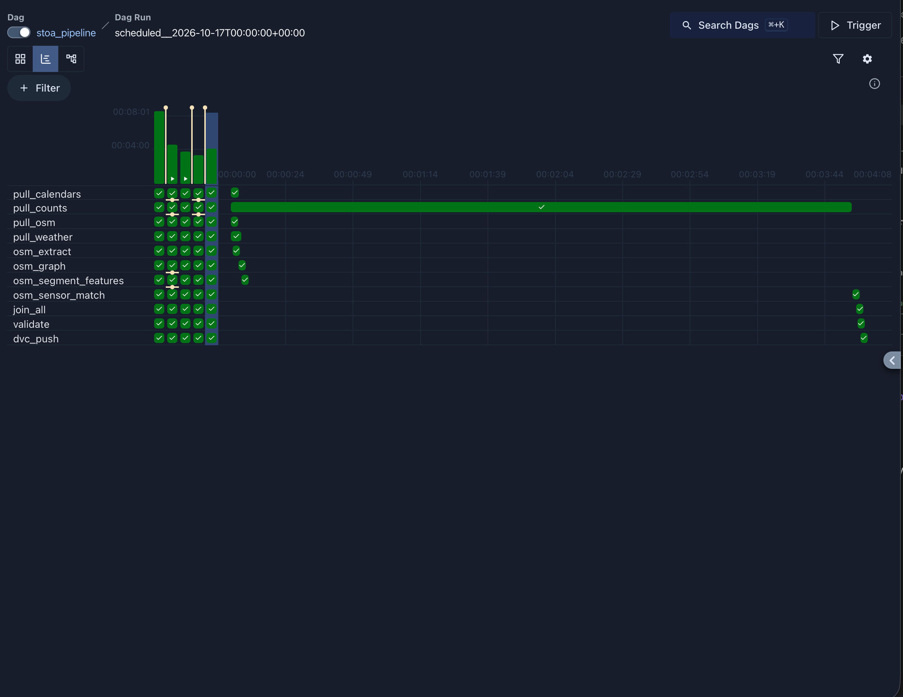
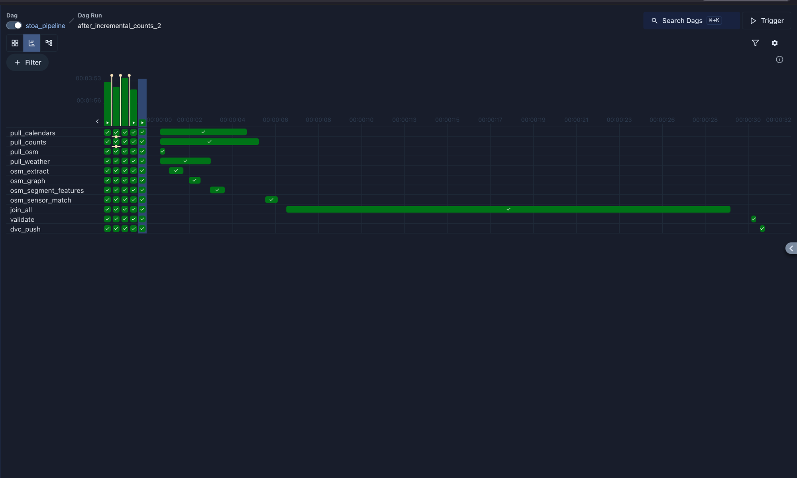
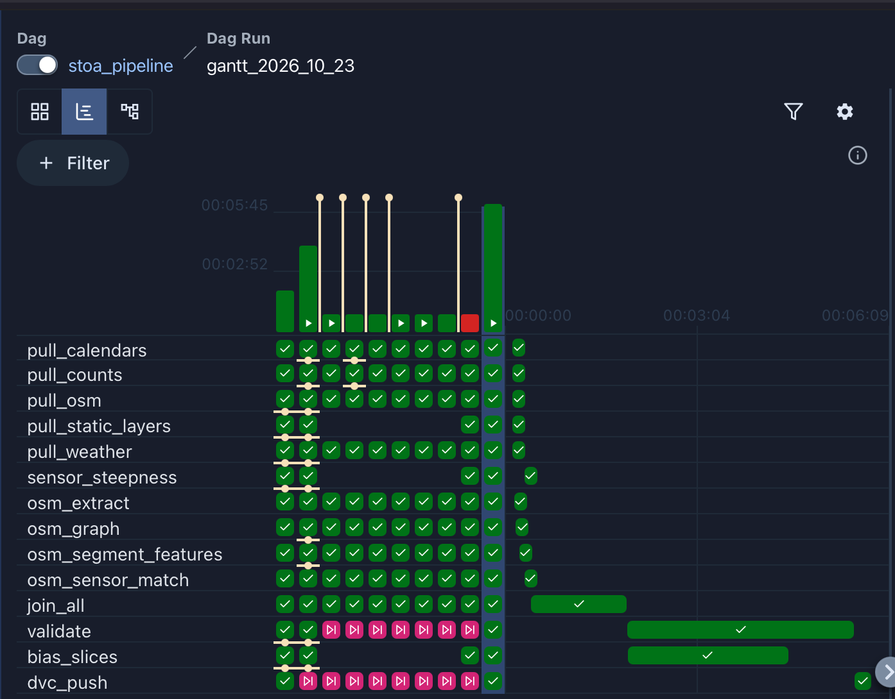

# Stoa

Predicts where people walk, how many, and when, on every path of a site, and lets planners test changes ("close this path", "add an entrance", "it's game day") before building them. It simulates crowds in limited outdoor areas and shows store owners the hourly pass-by at a candidate storefront and how many passersby can see it.

IE7374 MLOps, Northeastern University, Fall 2026. *Formerly DesireLine.*

**Team:** Romit Basak · Arshmehar Kaur · Bimbasri Paduru · Puneet Singh Puri · Shubham Madhusudan Hadawle

## Case studies

| Site | Role |
|---|---|
| Melbourne | Training and validation. All accuracy claims rest here (City of Melbourne pedestrian sensors, 2009–present). |
| Melbourne precincts (UniMelb edge, Carlton, North Melbourne) | Within-city transfer test: held out whole |
| New York City | Cross-city transfer test on NYC DOT's open counts (evaluation only, never training) |
| NEU Boston campus | Demonstration (no local ground truth) |
| Event scenario | Demonstration. Melbourne event days (centred on Marvel Stadium) are evaluated separately. |
| Marathons (stretch) | Melbourne Marathon (validation) and Boston Marathon (demonstration) |

## Status

| Module | Path | Status |
|---|---|---|
| Ingestion | `src/ingest/` | ✅ Melbourne: counts, City of Melbourne layers, OSM, DEM, WorldCover, weather, AFL fixtures and crowds, calendars. ✅ NEU Boston: terrain, buildings, imagery, OSM, land cover, weather. ✅ NYC: test counts, OSM, land cover, weather |
| Features | `src/features/` | ✅ OSM: walking graph, per-segment features (tags, amenities, opening hours, built form, transit, network and angular metrics), sensor matching for Melbourne. See [docs/features/osm_features.md](docs/features/osm_features.md). ✅ Footpath slope and elevation per sensor. ✅ Hourly table for Melbourne: counts + time + weather + calendars + slope, with the November 2022 to October 2024 gap filled from a Wayback copy, September 2010's hours recovered and the 18 retired sensors located ([docs/features/counts_hourly.md](docs/features/counts_hourly.md)). Shade and other City of Melbourne layers planned |
| Flow model | `src/models/flow/` | Planned (baseline ladder → gradient boosting; spatio-temporal GNN is a stretch goal) |
| Path segmentation | `src/models/segmentation/` | Planned (NEU campus) |
| Agents | `src/agents/` | Planned: LLM intake agent with local-knowledge adjustments (planning assistant is a stretch goal) |
| Simulation | `src/simulation/` | Planned: route-sampling walkers, then microsimulation for limited areas |
| Viewshed | `src/viewshed/` | Planned (integrating the existing engine) |
| API / web app | `src/api/`, `app/` | Planned (map, scenario builder, store-siting view, cached replay mode) |
| MLOps (Airflow, DVC, MLflow, CI/CD, Cloud Run) | `dags/` | ✅ Airflow: daily `stoa_pipeline` DAG with retries, failure emails and logging. ✅ DVC (data in `gs://stoa-dvc-data`). ✅ Data validation: schema, statistics and anomaly checks with Great Expectations ([docs/pipeline/validation.md](docs/pipeline/validation.md)). ✅ Bias slicing: representation per slice, a baseline's error per slice on held-out sensors, and mitigations tried ([docs/bias/bias_slicing.md](docs/bias/bias_slicing.md)). MLflow, CI/CD, Cloud Run planned |

## Setup

Requires Python 3.11+ and [uv](https://docs.astral.sh/uv/).

```bash
uv venv .venv
uv pip install --python .venv/bin/python -e ".[dev]"
```

Without uv, `requirements.txt` pins the exact versions we tested with: `pip install -r requirements.txt` (Python 3.11). `pyproject.toml` is the source of truth; after changing its dependencies, regenerate the pins with `uv pip compile pyproject.toml --extra dev --python-version 3.11 -o requirements.txt`.

### Get the data (DVC)

Data is not in git. It is versioned with [DVC](https://dvc.org) and stored in the `gs://stoa-dvc-data` bucket on the team's GCP project (ask Romit for access). Git holds only the pointer files `data/raw.dvc`, `data/interim.dvc` and `data/processed.dvc`.

```bash
gcloud auth application-default login    # once; sign in with the account added to the project
.venv/bin/dvc pull                       # downloads data/ at the version this commit points to
```

**No access to the bucket?** You don't need it to run the pipeline. Skip `dvc pull`: every input comes from public sources (the City of Melbourne portal, the Internet Archive's copy of the counts export, OpenStreetMap, Open-Meteo, Geoscience Australia, AFL Tables and the calendars in `configs/`), and the first Airflow run downloads and builds all of it (see "Run the pipeline" for how long that takes). The only difference is at the end: without a key, `dvc_push` is skipped instead of uploading a new version, and the run still succeeds. The data you get covers the same years as the team's, plus whatever the portal has published since.

The pipeline's `dvc_push` task saves and uploads a new version after every run that passes validation (see "Run the pipeline"). To do it by hand after changing data, save a new version and commit its pointers:

```bash
.venv/bin/dvc add data/raw data/interim data/processed
.venv/bin/dvc commit --force dvc.yaml   # record each stage's inputs in dvc.lock
.venv/bin/dvc push
git add data/*.dvc dvc.lock && git commit -m "..."
```

**Pipeline stages (`dvc.yaml`).** `dvc.yaml` lists the pipeline's stages, one per Airflow task, with each stage's command and inputs: its code, configs and the data it reads. `dvc.lock` records the exact version of every input for the data version committed with it, so a data version can be traced to the code and settings that produced it. To see which stages' results are out of date, and why:

```bash
.venv/bin/dvc status   # e.g. "validate: changed deps: modified: configs/validation.yaml"
.venv/bin/dvc dag      # the stages and the tracked data folders
```

The stages list no outputs. `data/raw`, `data/interim` and `data/processed` are versioned as whole folders (`data/*.dvc`), and DVC doesn't allow a stage output inside a tracked folder. So DVC can't order the stages by itself: run the pipeline with Airflow (below), not `dvc repro`. The download stages always show as changed, because they fetch new data on every run.

## Usage

### Pull data

Every source is configured in `configs/data.yaml`. Each script writes to `data/raw/<source>/` with a `MANIFEST.json` (URL, SHA-256, retrieval time, license).

```bash
# Melbourne (training)
.venv/bin/python -m src.ingest.melbourne_portal   # counts + archive, network, buildings, trees, POIs (~570 MB)
.venv/bin/python -m src.ingest.osm                # BBBike Melbourne extract (~90 MB)
.venv/bin/python -m src.ingest.dem                # GA 5 m LiDAR DEM clip + 30 m comparisons
.venv/bin/python -m src.ingest.worldcover         # ESA WorldCover 2021, clipped
.venv/bin/python -m src.ingest.weather            # hourly ERA5 via Open-Meteo, 2009–now
.venv/bin/python -m src.ingest.events             # AFL fixtures (Squiggle)
.venv/bin/python -m src.ingest.afl_attendance     # AFL crowd figures (AFL Tables)
.venv/bin/python -m src.ingest.calendars          # public holidays per site + Vic Important Dates

# NEU Boston (demonstration)
.venv/bin/python -m src.ingest.dem --site neu_boston          # USGS 3DEP 1 m clip
.venv/bin/python -m src.ingest.boston_buildings               # footprints with heights
.venv/bin/python -m src.ingest.imagery                        # NAIP 2023 clip + MassGIS 2025 tiles (~310 MB)

# NYC (cross-city transfer test only)
.venv/bin/python -m src.ingest.nyc                            # NYC DOT counts (~150 MB)

# OSM, land cover and weather for the other sites
.venv/bin/python -m src.ingest.osm --site neu_boston          # likewise worldcover, weather; and --site nyc
```

Options:
- `melbourne_portal --only <dataset-id> ...` fetches specific datasets.
- `melbourne_portal --large` also fetches the multi-GB 2018 DSM and point cloud.
- The live counts table is a rolling ~2-year window, so re-pulls are merged into the rows already held, never overwritten.
- `osm`, `dem`, `worldcover` and `weather` take `--site` (`melbourne`, `neu_boston`, `nyc`; see `configs/data.yaml`).
- `osm` keeps an existing extract (graph segment IDs belong to one extract); `--refresh` downloads the latest.
- `weather` re-fetches only missing years and the last two; `--full` re-fetches every year.
- School terms and university teaching periods are hand-maintained in `configs/calendars/`.

### Build features

```bash
.venv/bin/python -m src.features.osm --site melbourne     # OSM graph + segment features + sensor matching (~2.5 min)
.venv/bin/python -m src.features.sensor_steepness         # footpath slope and elevation per sensor (~5 s)
.venv/bin/python -m src.features.counts_hourly            # hourly table: counts + time + weather + calendars + slope (~30 s)
.venv/bin/python -m src.bias.representation               # bias slices: how much data each group has (~40 s)
.venv/bin/python -m src.bias.slice_errors                 # bias: baseline error per slice and mitigations (~18 min)
```

Outputs go to `data/interim/osm/<site>/` (GeoParquet layers and the graph) and `data/processed/features/<site>/`. `sensor_osm_features.parquet` joins onto the counts on `location_id`. The column dictionary, join recipe and caveats are in [docs/features/osm_features.md](docs/features/osm_features.md). `counts_hourly.parquet` is the hourly training table (one row per sensor and hour); see [docs/features/counts_hourly.md](docs/features/counts_hourly.md), including how it handles daylight saving. `sensor_steepness.parquet` gives each outdoor sensor its footpath slope and elevation (from Shubham Hadawle's join notebook), and the hourly table carries those columns.

### Run the pipeline (Airflow)

The Melbourne pipeline runs as one Airflow DAG, `stoa_pipeline` (`dags/stoa_pipeline.py`), in Docker. Requires Docker Desktop. The NYC (transfer test only) and NEU Boston (demonstration) data aren't in the DAG: they are one-off downloads of fixed snapshots, run by hand with the commands under "Pull data" and versioned with DVC like the rest.

On Linux, first tell the containers to run as your user, or they can't write to `data/`. Docker Desktop on macOS and Windows handles this for you.

```bash
echo "AIRFLOW_UID=$(id -u)" >> .env
```

```bash
docker compose up -d --build     # first run builds the image (a few minutes)
# open http://localhost:8080 (no login locally), unpause stoa_pipeline, press Trigger
docker compose down              # stop; add -v to also wipe Airflow's database
```

**How long the first run takes.** On a fresh clone with no data, the first run downloads and builds everything, so it takes about **20 minutes**. Measured on 23 October 2026 (Docker Desktop with its default 8 GB, a clean clone): 21 minutes from `git clone` to the end of the run. Most of it is three tasks:
- `pull_counts`, about 3.5 min: the 2009–2022 archive, the 171 MB Wayback copy from the Internet Archive (often slow) and the live table;
- the OSM stages, about 2.5 min: the walking network and segment features, built once;
- `bias_errors`, about 14 min: it trains 15 models, and on a first run there is no earlier result to reuse.

A task that shows as running for several minutes isn't stuck: its log (click the task, then Logs) shows its progress, e.g. `bias_errors` logs each model it trains. Later daily runs reuse what's held: about 6 minutes, with `bias_errors` rerunning only weekly.

The repo is mounted into the containers, so code changes apply on the next run; changes to `pyproject.toml` dependencies need `--build`. Data is written to `data/` on the host, as when running the modules directly.

```
pull_counts ────────────────────────────────────────────┐
pull_osm ─► osm_extract ─► osm_graph ─► osm_segment_features ─► osm_sensor_match ─┐
pull_static_layers ─► sensor_steepness ───────────────────────────────────────────┤
pull_weather ─────────────────────────────────────────────────────────────────────┼─► join_all ─► validate ─► bias_slices ─► bias_errors ─► dvc_push
pull_calendars ───────────────────────────────────────────────────────────────────┘
```

(`pull_counts` also feeds `osm_sensor_match` and `sensor_steepness`, which need the sensor locations. `pull_static_layers` fetches the footpath-steepness survey, the 5 m DEM, the CLUE areas and the AFL crowds only when they aren't held yet, and also feeds `bias_slices`. `bias_slices` reports how much data each bias slice has, and `bias_errors` a baseline model's error per slice with and without mitigations; `bias_errors` takes about 18 minutes, so it reruns weekly or when its settings change and otherwise finishes at once. See [docs/bias/bias_slicing.md](docs/bias/bias_slicing.md).) It runs daily so no day of the counts' rolling window is missed; each task retries twice, except `validate`. `validate` checks the hourly table before it's versioned (below), and the bias tasks run after it, so they only see data that passed. They don't run beside it because each loads the whole table (about 3 GB at 7.4M rows), and together they overran Docker Desktop's default 8 GB. `dvc_push` saves the result as a new DVC version (below). A daily run takes about 6 minutes in Docker; `validate` and `bias_slices`, which each read the whole hourly table (7.4M rows), and `join_all` are the slowest tasks (see "Pipeline optimization" below).

What a daily run re-does:
- **Counts:** only the days from two before the latest date held, merged into the rows already held on (location, date, hour). The fixed 2009–2022 archive is kept. `python -m src.ingest.melbourne_portal --only pedestrian-counting-system-monthly-counts-per-hour --full` re-fetches everything.
- **Weather:** only the last two years (`--full` re-fetches all).
- **OSM:** the extract is pinned. `pull_osm` keeps the file it has, and each OSM stage skips itself unless one of its inputs changed: the extract, `configs/features.yaml`, the code in `src/features/`, the sensor locations, or `configs/sensor_overrides.yaml`. A skipped OSM chain takes a couple of seconds.

To move to a newer OSM extract, trigger the DAG with the `refresh_osm` parameter set to true (Trigger → advanced options in the UI). That renumbers the graph segments, so `osm_sensor_match` fails until any sensor overrides that point at old segments are fixed.

**Failure alerts.** When a task fails after its last retry, Airflow emails the team (task, run and a link to the log). Settings live in `.env` in the repo root, which is git-ignored; without it, alerts are off. The sender needs a Gmail [App Password](https://myaccount.google.com/apppasswords) (requires 2-Step Verification), not the account password:

```bash
STOA_SMTP_USER=you@gmail.com
STOA_SMTP_PASSWORD=abcdefghijklmnop          # 16-character App Password, no spaces
STOA_ALERT_EMAILS=a@northeastern.edu,b@northeastern.edu
```

After editing `.env`, run `docker compose up -d` to apply it.

**Data versioning (`dvc_push`).** The last task runs `python -m src.pipeline.dvc_push`: `dvc add` on `data/raw`, `data/interim` and `data/processed`, `dvc commit` to record each stage's inputs in `dvc.lock`, then `dvc push` to `gs://stoa-dvc-data`. It runs after `validate`, so only data that passed the checks becomes a version. It does not commit to git: when the data changed, its log ends with the `git add data/*.dvc dvc.lock && git commit` command to run. Commit those files to record the version; until then, teammates' `dvc pull` still fetches the previous one.

The containers log in to the bucket as the `stoa-airflow-dvc` service account, through a key file in `.secrets/` (git-ignored, never shared; each person makes their own). Once, with `gcloud` signed in to an account on the project:

```bash
mkdir -p .secrets
gcloud iam service-accounts keys create .secrets/stoa-airflow-dvc.json \
  --iam-account=stoa-airflow-dvc@stoa-511822.iam.gserviceaccount.com
```

`dvc_push` finds credentials the way Google's own tools do: this key file, else your `gcloud auth application-default login`, else the service account of the Google Cloud VM it runs on (so a VM needs no key file).

With no credentials at all, every other task still runs and `dvc_push` is **skipped** (shown pink in the UI) with a warning in its log, so the run still succeeds and no failure email is sent. That is the expected result on a clone by someone outside the team: the pipeline builds all the data from public sources, it just isn't versioned. On team machines, add this to `.env` so a missing key fails the task and sends the failure email instead:

```bash
STOA_REQUIRE_DVC_PUSH=1
```

**Logs and error handling.** Every command logs what it does with Python's `logging` (set up once in `src/ingest/common.py`): each download with its size, retries, skipped steps and row counts. In Airflow, open a run, click a task and choose Logs. The same files are written to `logs/` in the repo (mounted in `docker-compose.yaml`, git-ignored), one folder per DAG, run and task, e.g. `logs/dag_id=stoa_pipeline/run_id=<run>/task_id=pull_counts/attempt=1.log`, so you can read or `grep` them without the UI. `download()` retries rate limits, server errors, dropped connections, timeouts and empty or cut-short files with backoff, writing to a `.part` file so a failed download never replaces the last good copy. If every try fails it raises `DownloadError` naming the URL; the task then fails, Airflow retries it twice, and the failure email links to the log.

**Data validation (`validate`).** `python -m src.pipeline.validate` checks the hourly table with a Great Expectations suite and its own anomaly checks: the schema in `configs/schemas/counts_hourly.yaml` (columns and types), unique sensor-hours, missing values only where documented, value ranges, per-sensor outliers, stuck sensors, gaps in the last week's daytime hours, and drift from the previous run's statistics. Each run saves a statistics profile and a report of every check to `data/processed/validation/melbourne/`, so DVC versions them with the data. **Errors** (broken schema, duplicate or negative counts, lost rows) fail the task without retrying: the team gets the failure email and `dvc_push` doesn't run, so bad data never becomes a version. **Warnings** (a new outlier, a quiet sensor, stale data) are logged as `WARN` lines and emailed to the team, and the run carries on. Thresholds are in `configs/validation.yaml`; every check is described in [docs/pipeline/validation.md](docs/pipeline/validation.md).

### Pipeline optimization

Airflow's Gantt chart (a run → Gantt) showed one bottleneck: `pull_counts` took 229 of 234 seconds, and every task after the OSM chain waited for it, because it re-downloaded the whole 2-year counts table (1.6M rows) and the 42 MB 2009–2022 archive on every run, to add one new day.

Fix: `pull_counts` now asks the portal only for rows from two days before the latest date held (the portal fills in the current day hour by hour, and older rows don't change), and keeps held attachments.

| Task | Before (s) | After (s) |
|---|---|---|
| `pull_counts` | 229.3 | 5.0 |
| Other ingest tasks | 7.1 | 7.2 |
| OSM stages (skipped, inputs unchanged) | 2.9 | 2.6 |
| `join_all` | placeholder | 22.5 |
| **Whole run** | **233.6** | **31.5** |

| Before (run of 2026-10-17 00:00 UTC) | After (run `after_incremental_counts_2`) |
|---|---|
|  |  |

At that point `join_all` was the slowest task. A run where `src/features/` or the OSM inputs changed also rebuilds the OSM stages (about 2.5 minutes, mostly `osm_segment_features`).

**The pipeline today.** Since then the DAG gained `pull_static_layers`, `sensor_steepness`, `bias_slices` and a real `validate`, so a daily run does more work. The run `gantt_2026_10_23` (a daily run with the OSM stages skipped and `dvc_push` uploading a new version) took 345 s:

| Task | Seconds |
|---|---|
| `validate` | 217.8 |
| `bias_slices` (ran beside `validate`; now after it) | 154.7 |
| `join_all` | 92.1 |
| `dvc_push` | 16.0 |
| `pull_counts` | 10.3 |
| Other ingest and OSM tasks (OSM skipped) | under 6 each |
| **Whole run** | **345.2** |



The `pull_counts` fix holds (10 s against 229 s). The new bottleneck is the stretch after `join_all`: `validate` and `bias_slices` run side by side, and each reads the whole hourly table (6.2M rows in this run; 7.4M since the Wayback fill of November 2022 to October 2024, so expect both to take somewhat longer now). Run alone, `validate` takes about 85 s in Docker; beside `bias_slices` it took 218 s, likely because the two compete for the Docker VM's CPU and 8 GB of memory (an observation from these runs, not yet measured separately). We kept full-table validation on purpose: it checks every row on every run, which is the stronger data-quality guarantee, and a daily run of about 6 minutes leaves the day's data ready well within the day. **Since then, `bias_slices` runs after `validate`.** After the Wayback fill grew the table to 7.4M rows, the two side by side needed about 7.7 GB (measured peaks: `validate` 3.3 GB, `bias_slices` 2.9 GB, plus about 1.5 GB for Airflow), more than Docker Desktop's default 8 GB VM can give, and `validate` was killed (exit -9) on a fresh-clone run. In sequence the peak is about 5 GB. It also removes the contention above, so each task runs near its solo time. If the run needs to be faster, the next steps are giving Docker more CPUs, and validating the fixed 2009–2022 archive rows once and only the new rows each day (`docs/pipeline/validation.md`, "Speed").

`bias_errors`, added after this run, comes after `bias_slices`. It trains the bias baseline five times per mitigation, about 18 minutes, so it reruns only when its last run is a week old or its settings changed; on other days it finishes at once and the daily run stays near 6 minutes.

While doing this we found that the portal's `id` is not unique (it glues location, hour and date: location 4 at hour 20 and location 42 at hour 2 share an id), so merging on it had dropped about 4.5% of rows. Counts are now merged on (location, date, hour).

### Tests and lint

```bash
.venv/bin/python -m pytest
.venv/bin/ruff check src tests && .venv/bin/ruff format src tests
```

The DAG tests (`tests/dags/`) need Airflow, so they skip in `.venv`. Run them in the Airflow image (no Postgres needed; the override gives the run a throwaway database):

```bash
docker compose run --rm --no-deps \
  -e AIRFLOW__DATABASE__SQL_ALCHEMY_CONN=sqlite:////tmp/airflow.db airflow-init \
  bash -c "pip install -q pytest && cd /opt/stoa && python -m pytest tests/dags"
```

## Repository layout

The pipeline code lives in `src/` (as a Python package, run with `python -m src.<module>`), which plays the role of the `scripts/` folder in the course's example structure.

```
configs/data.yaml        data sources and site bounding boxes
configs/calendars/       hand-maintained school terms and university teaching periods
configs/analysis.yaml    parameters for src/analysis/
configs/features.yaml    feature pipeline settings (walk filter, POI categories, radii, sensor matching)
configs/sensor_overrides.yaml  hand-checked sensor-to-segment matches
configs/bias.yaml        bias slices: precincts, time and weather bins, eras, thresholds
configs/validation.yaml  data validation thresholds; configs/schemas/ holds the expected table schema
dags/                    Airflow DAGs (stoa_pipeline.py); Dockerfile + docker-compose.yaml run them
data/                    raw/, interim/ and processed/ (git-ignored; versioned with DVC, pointers in data/*.dvc)
dvc.yaml, dvc.lock       pipeline stages with their inputs, and the input versions behind the committed data
logs/                    Airflow task logs (written by the containers, git-ignored)
docs/
  data_cards/            one card per dataset: schema, coverage, known issues
  analysis/              write-ups of one-off analyses
  features/              feature tables: how to build, column dictionaries, joins
  bias/                  bias analysis: slices, representation, per-slice errors, mitigations, findings
  pipeline/              data validation checks, Gantt charts
  data_licenses.md       license register; check before adding any dataset
  PROJECT_CONTEXT.md     reasoning behind decisions, scope tiers, validation plan
  scoping/               project scoping document (LaTeX source; the PDF is built, not tracked)
src/ingest/              ingestion scripts (common.py = download + manifest helpers)
src/features/            feature pipeline (osm.py runs extract -> graph -> features -> sensors)
src/bias/                bias slicing (slices.py), representation report, per-slice errors (slice_errors.py)
src/pipeline/            pipeline steps that aren't ingest or features: validate, dvc_push
src/analysis/            one-off analyses (e.g. new_openings: before/after study feasibility)
notebooks/               exploration and demonstration only; the pipeline doesn't run them (see below)
tests/                   mirrors src/; tests/dags/ checks the DAG (run in the Airflow image)
requirements.txt         pinned versions generated from pyproject.toml
CLAUDE.md                project rules and conventions
```

### Notebooks are not the pipeline

`notebooks/` holds exploration and demonstration notebooks. Airflow doesn't run them, and nothing the pipeline produces depends on them. Each one was written while working out a step, and that step now lives in `src/`, where the DAG runs it and `tests/` tests it:

| Notebook | What it explored | Where the pipeline does it | DAG task |
|---|---|---|---|
| `01_download` | Downloading the counts, sensor tables, footpath steepness, DEM and weather | `src/ingest/melbourne_portal.py`, `weather.py`, `dem.py` | `pull_counts`, `pull_weather`, `pull_static_layers` |
| `02_combine` | Merging the archive, live table and Wayback copy; the September 2010 fix; daylight saving; locations for retired sensors; the weather join | `src/features/counts_hourly.py`, `sensor_match.py` (`load_sensor_locations`) | `join_all`, `osm_sensor_match` |
| `03_preprocess` | Footpath slope with a DEM fallback; outage zeros; quality checks | `src/features/sensor_steepness.py`, `counts_hourly.py`, `src/pipeline/validate.py` | `sensor_steepness`, `join_all`, `validate` |
| `04_bias_slicing` | Figures for the bias write-up, drawn from the pipeline's bias outputs | reads `data/processed/bias/` from `src/bias/representation.py` | `bias_slices` |
| `05_bias_stage1` | The representation check on the notebooks' own dataset | `src/bias/representation.py` | `bias_slices` |

The notebooks' tables differ from the pipeline's in a few documented ways (UTC-only time, four weather variables, a different outage-zero rule); see `notebooks/README.md`. Use the pipeline's tables (`dvc pull`, or a DAG run) for anything that feeds a model.

## Data at a glance

| Source | Coverage | License |
|---|---|---|
| Melbourne pedestrian counts | 2009-05 → 2022-10 (archive) and 2024-10 → now (live, rolling window); **no data Nov 2022 – Oct 2024**. Directional counts only in the live window. Metro Tunnel break from 2025-11-30. | CC BY 4.0 (portal-wide terms) |
| City of Melbourne layers (pedestrian network, footpath slope, buildings, trees, businesses, toilets, fountains, …) | Municipality | CC BY 4.0 |
| OpenStreetMap | Melbourne metro | ODbL 1.0 |
| GA 5 m LiDAR DEM | Study area (has land voids stored as 0) | CC BY 4.0 |
| ESA WorldCover 2021 | Study area | CC BY 4.0 |
| Weather (ERA5 via Open-Meteo) | 2009 → now, hourly | CC BY 4.0; free API is non-commercial |
| AFL games (Squiggle) + crowds (AFL Tables) | 2009 → now | No published licence (facts; credit both) |
| Holidays and calendars | 2007–2027 holidays; Vic school terms 2009–2026; UniMelb 2015–2026; NEU 2026–27 | `holidays` (MIT); Vic Gov CC BY 4.0; facts |
| NEU Boston: USGS 3DEP 1 m, Boston buildings, NAIP 2023, MassGIS 2025 orthos | Campus + ~400 m | Public domain; buildings PDDL |
| NYC DOT pedestrian counts | 114 locations, 2007 → May 2026, period totals | NYC Open Data Law (no use restrictions). **Evaluation only** |
| Stanford Drone Dataset (not pulled) | 8 scenes, 60 videos | CC BY-NC-SA 3.0: validation and academic demonstration only; no model fine-tuned on it is shipped or distributed |

Details and caveats are in [`docs/data_cards/`](docs/data_cards/) and [`docs/data_licenses.md`](docs/data_licenses.md).

**Attribution:** Source: City of Melbourne Open Data · © OpenStreetMap contributors · © Commonwealth of Australia (Geoscience Australia) · © ESA WorldCover project 2021 / Contains modified Copernicus Sentinel data (2021) · Weather data by Open-Meteo.com (ERA5, Copernicus/ECMWF) · AFL data via Squiggle and AFL Tables · © State of Victoria · USGS 3DEP · USDA FSA NAIP · MassGIS (Bureau of Geographic Information), Commonwealth of Massachusetts EOTSS · City of Boston · NYC Department of Transportation, via NYC Open Data.

## Ground rules

The full list is in [`CLAUDE.md`](CLAUDE.md). The short version:

- Numbers come from models; the LLM only parses input and narrates results.
- Split by location, not by time. Never evaluate on sensors, areas or tiles seen in training.
- No personal data, no phone tracking, no manual people-counting.
- Non-commercial datasets are for validation and academic demonstration only; no model fine-tuned on them is shipped or distributed.
- Features must transfer: no location IDs, no calendar month. Effects not learnable from Melbourne (ice, class-change surges) are labeled assumptions or left out.
- Outputs, including crowd simulations, are planning guidance, not crowd-safety certification. Amenity what-ifs and user-entered local knowledge are labeled as assumptions.

## Contributing

- Keep PRs small and focused. State which module and interface each PR touches.
- New features need tests. Model changes need an eval run.
- Config goes in `configs/`. No hard-coded paths, credentials or API keys.
- Before starting work, check its tier (Tier 1 deliverables before Tier 2 stretch goals). See `docs/PROJECT_CONTEXT.md` §11.
