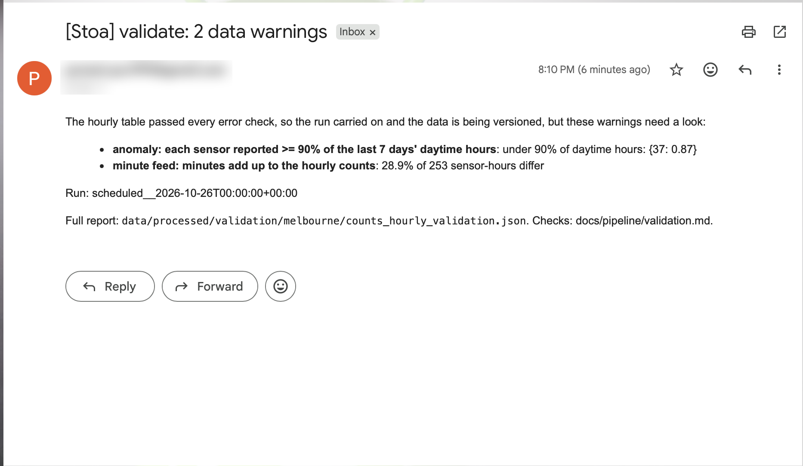
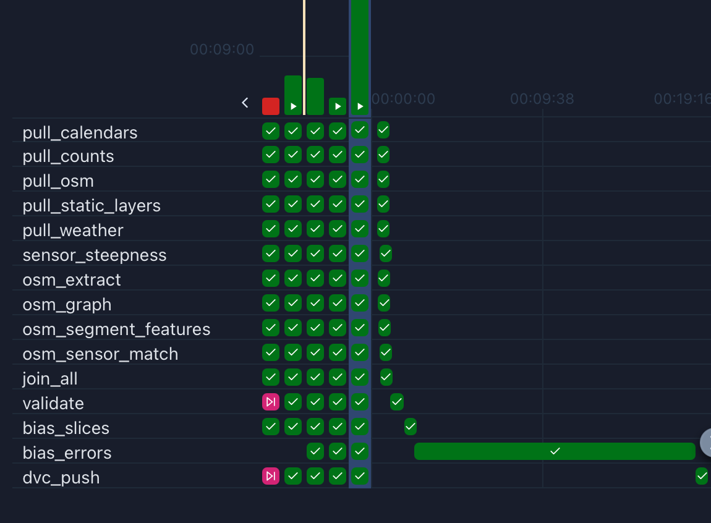

# Stoa

Stoa predicts where people walk, how many, and when, on every path of a site. Planners can test a change ("close this path", "add an entrance", "it's game day") before building it, and store owners can see the hourly pass-by at a candidate storefront and how many of those people can see it.

We train on the City of Melbourne's pedestrian sensors: 118 sensors, hourly counts from 2009 to today, 7.4 million sensor-hours. This repo is the data pipeline that pulls those counts and everything around them (weather, calendars, the street network, terrain), turns them into one clean hourly table, checks it, measures bias in it, and versions it.

IE7374 MLOps, Northeastern University, Fall 2026. *Formerly DesireLine.*

**Team:** Romit Basak · Arshmehar Kaur · Bimbasri Paduru · Puneet Singh Puri · Shubham Madhusudan Hadawle

## Where each requirement lives

| Course requirement | Where to look |
|---|---|
| Data acquisition | `src/ingest/`, sources listed in `configs/data.yaml`. See [Running steps by hand](#running-steps-by-hand) |
| Preprocessing and features | `src/features/`. The hourly table is described in [docs/features/counts_hourly.md](docs/features/counts_hourly.md) |
| Airflow DAG | `dags/stoa_pipeline.py`. See [The pipeline](#the-pipeline) |
| Data versioning (DVC) | `data/*.dvc`, `dvc.yaml`, `dvc.lock`. See [Data versioning with DVC](#data-versioning-with-dvc) |
| Schema and statistics | `src/pipeline/validate.py`, `configs/schemas/counts_hourly.yaml`. See [Validation, anomalies and alerts](#validation-anomalies-and-alerts) |
| Anomaly detection and alerts | Same section; every check is listed in [docs/pipeline/validation.md](docs/pipeline/validation.md) |
| Logging and error handling | [Logging and error handling](#logging-and-error-handling) |
| Bias detection and mitigation | `src/bias/`. Summary in [Bias detection and mitigation](#bias-detection-and-mitigation), full write-up in [docs/bias/bias_slicing.md](docs/bias/bias_slicing.md) |
| Pipeline optimization (Gantt) | [Pipeline optimization](#pipeline-optimization) |
| Tests | `tests/`, which mirrors `src/`. See [Tests and lint](#tests-and-lint) |
| Reproducibility | [Quickstart](#quickstart) |
| Folder structure | [Repository layout](#repository-layout) |

## Quickstart

Give Docker at least 8 GB of memory (Docker Desktop → Settings → Resources). You don't need any credentials: every input comes from public sources, so the first run downloads and builds everything itself.

```bash
git clone https://github.com/romit-basak/Stoa.git && cd Stoa
echo "AIRFLOW_UID=$(id -u)" >> .env    # Linux only, so the containers can write to data/
docker compose up -d --build           # the first build takes a few minutes
```

Open http://localhost:8080 (no login locally) and unpause `stoa_pipeline`. On a fresh clone, unpausing starts the first run by itself, so there's no need to press Trigger (a Trigger would queue a second run behind it); use Trigger for later runs. When you're done, run `docker compose down` (add `-v` to also wipe Airflow's database).

**How long it takes.** The first run takes about 22 minutes (measured on a clean clone on 25 October 2026: about 6 minutes to download and build the data, then 16 for `bias_errors`). Most of that is `bias_errors` (about 16 minutes, because it trains 15 models), pulling the counts (including a 171 MB copy from the Internet Archive, which is often slow), and building the street network once. Later runs reuse what's already there and take about 2 minutes; `bias_errors` retrains only once a week. A task that runs for several minutes isn't stuck: click it, then Logs, to watch its progress. Don't mark it as success to move on: Airflow stops a running task when it's marked, so its results are never written.

**What you'll see without credentials.** `pull_minute_feed` and `dvc_push` need access to the team's bucket, so on your machine they show as skipped (pink). The run still succeeds and no failure email goes out. Leave the second DAG, `stoa_minute_feed`, paused: it only feeds the team's per-minute archive.

The repo is mounted into the containers, so code changes apply on the next run. Changes to dependencies in `pyproject.toml` need `docker compose up -d --build`. Data is written to `data/` on your machine.

## Setup for local development

To run modules or tests outside Docker, you need Python 3.11+ and [uv](https://docs.astral.sh/uv/):

```bash
uv venv .venv
uv pip install --python .venv/bin/python -e ".[dev]"
```

Without uv, `pip install -r requirements.txt` (Python 3.11) installs the exact versions we tested with. `pyproject.toml` is the source of truth. After changing its dependencies, regenerate the pins with `uv pip compile pyproject.toml --extra dev --python-version 3.11 -o requirements.txt`.

## The pipeline

One Airflow DAG, `stoa_pipeline` (`dags/stoa_pipeline.py`), runs the Melbourne pipeline in Docker every day. It runs daily to keep the table current; if a day is missed, the next run picks it up. Each task runs one module from `src/` exactly as you would by hand.

```
pull_counts ──────────────────────────────────────────────────────────────────────┐
pull_osm ─► osm_extract ─► osm_graph ─► osm_segment_features ─► osm_sensor_match ─┤
pull_static_layers ─► sensor_steepness ───────────────────────────────────────────┤
pull_weather ─────────────────────────────────────────────────────────────────────┼─► join_all ─┐
pull_calendars ───────────────────────────────────────────────────────────────────┘             ├─► validate
pull_minute_feed ───────────────────────────────────────────────────────────────────────────────┘

validate ─┬─► bias_slices ─────┬─► bias_errors ──────┐
          │                    │                     ├─► dvc_push
          └─► minute_profiles ─┴─► minute_coverage ──┘
```

`pull_counts` also feeds `osm_sensor_match` and `sensor_steepness`, which need the sensor locations, and `pull_static_layers` also feeds `bias_slices`.

| Task | What it does |
|---|---|
| `pull_counts` | Hourly counts and sensor locations from the City of Melbourne portal |
| `pull_weather` | Hourly weather (ERA5 via Open-Meteo) |
| `pull_calendars` | Public holidays, plus the school and university terms kept in `configs/calendars/` |
| `pull_static_layers` | Footpath-steepness survey, 5 m terrain model, CLUE areas (the City's precincts) and AFL crowds, each fetched only if it isn't already on disk |
| `pull_osm`, `osm_*` | The OpenStreetMap extract, the walking graph, per-segment features, and each sensor's matching segment |
| `sensor_steepness` | Footpath slope and elevation at each sensor |
| `pull_minute_feed` | Copies the per-minute counts archive from the bucket into `data/raw` |
| `join_all` | Builds the hourly table, `counts_hourly.parquet`: one row per sensor and hour, with time, weather, calendar, slope and street features |
| `validate` | Checks the table's schema, values, anomalies and drift. Fails the run on errors |
| `bias_slices` | How much data each group (place, time, weather, era...) has |
| `bias_errors` | A baseline model's error for each group, with and without mitigations. Retrains weekly |
| `minute_profiles` | How people spread across the minutes of each hour, from the per-minute archive |
| `minute_coverage` | Which groups the per-minute profiles under-cover, and the pooled profiles that fix it |
| `dvc_push` | Saves the result as a new DVC version |

How it's set up:
- Each task retries twice, five minutes apart. The exception is `validate`: bad data fails the same way every time, so retrying would only delay the alert.
- `validate` runs even when `pull_minute_feed` is skipped, but not when an earlier task fails.
- `catchup` is off, because the next run's merge covers a missed day. Only one run goes at a time, since two would write the same files.
- The bias tasks run after `validate`, so they only see data that passed. Running them side by side also ran out of memory (see [Pipeline optimization](#pipeline-optimization)).

What a daily run re-does:
- **Counts:** only the days from two before the latest date we hold, merged into the rows we already have on (location, date, hour). The fixed 2009–2022 archive is kept. To re-fetch everything: `python -m src.ingest.melbourne_portal --only pedestrian-counting-system-monthly-counts-per-hour --full`.
- **Weather:** only the last two years (`--full` re-fetches all of it).
- **OpenStreetMap:** the extract is pinned. Each OSM stage skips itself unless one of its inputs changed: the extract, `configs/features.yaml`, the code in `src/features/`, the sensor locations, or `configs/sensor_overrides.yaml`. A skipped OSM chain takes a couple of seconds.

To move to a newer OSM extract, trigger the DAG with `refresh_osm` set to true (Trigger, then advanced options). That renumbers the graph's segments, so `osm_sensor_match` fails until any sensor overrides that point at old segments are fixed.

NYC (a transfer test only) and NEU Boston (a demonstration) aren't in the DAG. They're fixed snapshots, downloaded once by hand (see [Running steps by hand](#running-steps-by-hand)) and versioned with DVC like the rest.

## Data versioning with DVC

Data isn't in git. DVC versions `data/raw`, `data/interim` and `data/processed` as whole folders and stores them in the `gs://stoa-dvc-data` bucket on the team's GCP project. Git holds only the pointer files (`data/*.dvc`) and `dvc.lock`.

**Getting the team's data** needs access to the bucket (ask Romit):

```bash
gcloud auth application-default login   # once, with the account added to the project
.venv/bin/dvc pull                      # downloads data/ at the version this commit points to
```

No access? Skip this. The first Airflow run builds the same data from public sources, and it covers the same years as ours plus whatever the portal has published since.

**Every good run becomes a version.** The last task, `dvc_push` (`src/pipeline/dvc_push.py`), runs `dvc add` on the three folders, `dvc commit` to record each stage's inputs in `dvc.lock`, then `dvc push`. It runs after `validate`, so only data that passed the checks is versioned. It doesn't commit to git: when the data changed, its log ends with the `git add data/*.dvc dvc.lock && git commit` command to run. Until someone commits those files, teammates' `dvc pull` still fetches the previous version.

To make a version by hand after changing data:

```bash
.venv/bin/dvc add data/raw data/interim data/processed
.venv/bin/dvc commit --force dvc.yaml   # record each stage's inputs in dvc.lock
.venv/bin/dvc push
git add data/*.dvc dvc.lock && git commit -m "..."
```

**Stages (`dvc.yaml`).** There's one stage per Airflow task, with its command and inputs: its code, configs and the data it reads. `dvc.lock` records the exact version of every input, so any data version can be traced back to the code and settings that produced it.

```bash
.venv/bin/dvc status   # which stages' inputs changed, e.g. "validate: changed deps: modified: configs/validation.yaml"
.venv/bin/dvc dag      # the stages
```

Don't use `dvc repro`; run the pipeline with Airflow. The stages list no outputs, because DVC doesn't allow a stage output inside a folder that's tracked as a whole, so DVC can't work out the order on its own. The download stages always show as changed, since they fetch new data on every run.

**Credentials for `dvc_push`.** The containers log in to the bucket as the `stoa-airflow-dvc` service account, using a key file in `.secrets/` (git-ignored; each person makes their own). Once, with `gcloud` signed in to an account on the project:

```bash
mkdir -p .secrets
gcloud iam service-accounts keys create .secrets/stoa-airflow-dvc.json \
  --iam-account=stoa-airflow-dvc@stoa-511822.iam.gserviceaccount.com
```

Without that key, `dvc_push` falls back to your `gcloud auth application-default login`, then to the service account of a Google Cloud VM. With no credentials at all it's skipped, with a warning in its log. On team machines, add `STOA_REQUIRE_DVC_PUSH=1` to `.env`: then a missing key fails the task and sends the failure email instead.

## Validation, anomalies and alerts

`validate` (`src/pipeline/validate.py`) checks the hourly table after `join_all` builds it and before anything is versioned. It uses a Great Expectations suite for the column checks and our own code for the anomaly checks:
- **Schema:** the columns and their types match `configs/schemas/counts_hourly.yaml`. When we add a feature on purpose, we regenerate it with `--write-schema` and commit it with the change.
- **Values:** one row per sensor-hour; no missing values except where documented; values in physical ranges; categories from an allowed list.
- **Anomalies:** new per-sensor outliers, stuck sensors, gaps in the last week's daytime hours, stale data, and too many outage zeros.
- **Drift:** row count, sensor count, missing values and mean count compared with the last good run.
- **The per-minute archive:** missing days, late polls, duplicate rows, and minutes that don't add up to the hourly counts.

**Statistics over time.** Every run writes a statistics profile of each column and a report of every check to `data/processed/validation/melbourne/`. Each good run adds a summary line to a history file, and the next run's drift checks compare against it. A failed run doesn't join the history, so bad data never becomes the baseline. These files sit under `data/processed/`, so DVC versions them with the data they describe.

**Errors and warnings.**
- **Errors** (a broken schema, duplicate or negative counts, lost rows) fail the task without retrying. The team gets the failure email, and `dvc_push` doesn't run, so bad data never becomes a version.
- **Warnings** (a new outlier, a quiet sensor, stale data) are logged as `WARN` lines and emailed to the team, and the run carries on. All per-minute checks are warnings.

The warning email from the run of 26 October 2026 (`scheduled__2026-10-26`): sensor 37 reported only 87% of its daytime hours in the last week, and the per-minute archive's minutes didn't add up to the hourly counts for 28.9% of sensor-hours. The run carried on and versioned the data. The sender's address is blurred.



Thresholds are in `configs/validation.yaml`. [docs/pipeline/validation.md](docs/pipeline/validation.md) describes every check and how we tested each one against planted errors.

**Setting up the alert emails.** When a task fails after its last retry, Airflow emails the team the task, the run and a link to the log. Validation warnings use the same settings. They live in `.env` in the repo root, which is git-ignored; without it, alerts are off. The sender needs a Gmail [App Password](https://myaccount.google.com/apppasswords) (this requires 2-Step Verification), not the account password:

```bash
STOA_SMTP_USER=you@gmail.com
STOA_SMTP_PASSWORD=abcdefghijklmnop          # 16-character App Password, no spaces
STOA_ALERT_EMAILS=a@northeastern.edu,b@northeastern.edu
```

Run `docker compose up -d` after editing `.env` to apply it.

## Logging and error handling

- Every module logs with Python's `logging` (set up once in `src/ingest/common.py`): each download with its size, retries, skipped steps and row counts.
- In Airflow, open a run, click a task and choose Logs. The same logs are written to `logs/` in the repo (git-ignored), one folder per DAG, run and task, so you can read or `grep` them without the UI. For example: `logs/dag_id=stoa_pipeline/run_id=<run>/task_id=pull_counts/attempt=1.log`.
- Every download writes a `MANIFEST.json` next to its files, with the URL, SHA-256, retrieval time and license.
- `download()` retries rate limits, server errors, dropped connections, timeouts, and empty or cut-short files, with backoff. It writes to a `.part` file first, so a failed download never replaces the last good copy. If every try fails, it raises `DownloadError` naming the URL. The task then fails, Airflow retries it twice, and the failure email links to the log.
- Without bucket credentials, `pull_minute_feed` and `dvc_push` exit with code 99, which Airflow treats as a skip rather than a failure.

## Bias detection and mitigation

Our data has no people in it. The counts are anonymous totals per sensor and hour, so there's no age or gender to slice on, by design. For a pedestrian model, the groups that can be served worse are places, times and conditions: a model trained mostly on busy city-centre streets in fine weather can look accurate overall and still be poor on a quiet street, at night or in the rain.

We slice the hourly table 20 ways, including precinct, how busy the sensor is, nearby amenities, slope, time of day, holidays, rain, temperature, era (before, during and after COVID) and AFL match days. The slices are defined in `configs/bias.yaml`.

1. **How much data each group has** (`bias_slices`). Each group's share is compared with a fair reference: hours in the study period for time and weather, walkable network for precincts, and footpath length for slope. Place is the most uneven: the city centre has five times its share of sensors, while Carlton, North Melbourne, Parkville and Kensington have about a third of theirs or less.
2. **Where a model does worse** (`bias_errors`). The real flow model comes later, so a gradient-boosting baseline stands in for it. It's trained in 5 folds with whole sensors held out. We measure its relative error (WAPE) per group with Fairlearn's `MetricFrame`, with 95% intervals from resampling sensors. Nine groups are clearly worse, including quiet sensors, sensors with few amenities nearby, night, public holidays and the COVID era. The thin outer precincts are not among them.
3. **Mitigation.** Reweighting the training rows (two ways) didn't lower the overall error and moved error from some weak groups onto others, so we rejected it. Calibrating each sensor to four weeks of its own counts cut the overall error by about a third (WAPE 0.55 to 0.38) and fixed the quiet, low-amenity and Southbank sensors. Night and COVID are still worse: their error is in the shape of the pattern, which needs changes to the model, not the weights.
4. **The per-minute data** (`minute_coverage`). The same slices showed the per-minute profiles under-cover quiet hours, so quiet hours are pooled by volume tier. On the first run that raised quiet sensors' coverage from 7% to 65%.

[docs/bias/bias_slicing.md](docs/bias/bias_slicing.md) has every number, the trade-offs we accepted, and the next steps.

## Pipeline optimization

We used Airflow's Gantt chart (open a run, then Gantt) to find the slow tasks, and made three changes.

**1. Download only the new counts.** The first Gantt chart showed `pull_counts` taking 229 of the run's 234 seconds. Everything after the OSM chain waited for it, because it re-downloaded the whole two-year table (1.6M rows) and the 42 MB 2009–2022 archive every day just to add one day. It now asks the portal only for rows from two days before the latest date we hold (the portal fills in the current day hour by hour, and older rows don't change).

| Task | Before (s) | After (s) |
|---|---|---|
| `pull_counts` | 229.3 | 5.0 |
| Other ingest tasks | 7.1 | 7.2 |
| OSM stages (skipped, inputs unchanged) | 2.9 | 2.6 |
| `join_all` | placeholder | 22.5 |
| **Whole run** | **233.6** | **31.5** |

| Before (run of 2026-10-17 00:00 UTC) | After (run `after_incremental_counts_2`) |
|---|---|
|  |  |

Along the way we found that the portal's `id` isn't unique. It glues together location, hour and date, so location 4 at hour 20 and location 42 at hour 2 share an id. Merging on it had silently dropped about 4.5% of rows. We now merge on (location, date, hour).

**2. Run `validate` and `bias_slices` one after the other.** They used to run side by side. Once the table reached 7.4M rows, together they needed about 7.7 GB (`validate` 3.3 GB, `bias_slices` 2.9 GB, plus about 1.5 GB for Airflow). That's more than Docker Desktop's default 8 GB can give, and `validate` was killed on a fresh-clone run. In sequence the peak is about 5 GB, and each task runs close to its solo time because they no longer compete for CPU.

**3. Speed up Great Expectations.** Profiling `validate` showed the Great Expectations suite was most of it: about 28 s, against 6 s for every other check together and 1 s to read the table. Two things in GX 1.x made it slow: its fast range check only runs on columns that are exactly `int64` or `float64` (ours are `int8`, `int32` and `float32`, so it fell back to a Python call per row), and before each check it copied the whole frame. Now each expectation gets a frame with just its own columns, widened to 64-bit. The suite takes 17 s instead of 28 and peaks at 3.9 GB instead of 5.0, with the same results (`run_expectations` in `src/pipeline/validate.py`).

**The pipeline today.** Two runs on 25 October 2026 (7,416,763 rows, Docker Desktop's default 8 GB, every task green on its first try) show a normal day and a day when `bias_errors` retrains:

| Task | Daily run (`bias_errors` skipped) | Weekly run (`bias_errors` trains) |
|---|---|---|
| `bias_errors` | 1 s | 950 s |
| `validate` | 41 s | 47 s |
| `join_all` | 40 s | 34 s |
| `bias_slices` | 29 s | 32 s |
| `pull_counts` | 6 s | 6 s |
| `dvc_push` | 4 s | 6 s |
| Other ingest and OSM tasks (OSM skipped) | 3 s or less each | 3 s or less each |
| **Whole run** | **127 s** | **1,081 s** |



A daily run takes about 2 minutes. Once a week, `bias_errors` adds about 16 minutes and is the whole bottleneck. That's fine for a weekly fairness report. If it needs to be faster, the next step is fewer folds or mitigations per run, or giving it a schedule of its own. These runs came before the minute tasks were added; those take a few seconds each.

## Tests and lint

```bash
.venv/bin/python -m pytest
.venv/bin/ruff check src tests && .venv/bin/ruff format src tests
```

The tests use small made-up tables and cover ingestion, features, validation (including planted errors such as negative counts, duplicate rows and dropped columns), bias, DVC versioning and the DAG itself. The DAG tests (`tests/dags/`) need Airflow, so they're skipped in `.venv`. To run them in the Airflow image (no Postgres needed; the override gives the run a throwaway database):

```bash
docker compose run --rm --no-deps \
  -e AIRFLOW__DATABASE__SQL_ALCHEMY_CONN=sqlite:////tmp/airflow.db airflow-init \
  bash -c "pip install -q pytest && cd /opt/stoa && python -m pytest tests/dags"
```

## Running steps by hand

Every task in the DAG is a module you can run yourself. Each source is configured in `configs/data.yaml`, and each script writes to `data/raw/<source>/` with a `MANIFEST.json`.

```bash
# Melbourne (training)
.venv/bin/python -m src.ingest.melbourne_portal   # counts + archive, network, buildings, trees, POIs (~570 MB)
.venv/bin/python -m src.ingest.osm                # BBBike Melbourne extract (~90 MB)
.venv/bin/python -m src.ingest.dem                # GA 5 m LiDAR DEM clip + 30 m comparisons
.venv/bin/python -m src.ingest.worldcover         # ESA WorldCover 2021, clipped
.venv/bin/python -m src.ingest.weather            # hourly ERA5 via Open-Meteo, 2009–now
.venv/bin/python -m src.ingest.events             # AFL fixtures (Squiggle)
.venv/bin/python -m src.ingest.afl_attendance     # AFL crowd figures (AFL Tables)
.venv/bin/python -m src.ingest.calendars          # public holidays per site + Vic Important Dates
.venv/bin/python -m src.ingest.minute_feed --sync # per-minute counts archived in the bucket since 25 Oct 2026

# NEU Boston (demonstration)
.venv/bin/python -m src.ingest.dem --site neu_boston          # USGS 3DEP 1 m clip
.venv/bin/python -m src.ingest.boston_buildings               # footprints with heights
.venv/bin/python -m src.ingest.imagery                        # NAIP 2023 clip + MassGIS 2025 tiles (~310 MB)

# NYC (cross-city transfer test only)
.venv/bin/python -m src.ingest.nyc                            # NYC DOT counts (~150 MB)

# OSM, land cover and weather for the other sites
.venv/bin/python -m src.ingest.osm --site neu_boston          # likewise worldcover, weather; and --site nyc
```

Useful options:
- `melbourne_portal --only <dataset-id> ...` fetches specific datasets; `--large` also fetches the multi-GB 2018 surface model and point cloud.
- The live counts table is a rolling two-year window, so new pulls are merged into the rows we hold, never written over them.
- `osm`, `dem`, `worldcover` and `weather` take `--site` (`melbourne`, `neu_boston` or `nyc`).
- `osm` keeps an existing extract, because graph segment IDs belong to one extract; `--refresh` downloads the latest.
- `weather` re-fetches only missing years and the last two; `--full` re-fetches every year.
- School terms and university teaching periods are maintained by hand in `configs/calendars/`.

Then build the features and bias reports:

```bash
.venv/bin/python -m src.features.osm --site melbourne     # OSM graph + segment features + sensor matching (~2.5 min)
.venv/bin/python -m src.features.sensor_steepness         # footpath slope and elevation per sensor (~5 s)
.venv/bin/python -m src.features.counts_hourly            # hourly table: counts + time + weather + calendars + slope (~30 s)
.venv/bin/python -m src.pipeline.validate                 # checks on the hourly table (~45 s)
.venv/bin/python -m src.bias.representation               # how much data each bias slice has (~40 s)
.venv/bin/python -m src.bias.slice_errors                 # baseline error per slice and mitigations (~16 min)
.venv/bin/python -m src.features.minute_profiles          # within-hour profiles from the per-minute archive (seconds)
.venv/bin/python -m src.bias.minute_coverage              # bias in the per-minute data, and pooled profiles (seconds)
```

Outputs go to `data/interim/osm/<site>/` (GeoParquet layers and the graph) and `data/processed/features/<site>/`:
- `counts_hourly.parquet` is the hourly training table, one row per sensor and hour. [docs/features/counts_hourly.md](docs/features/counts_hourly.md) explains it, including how it handles daylight saving.
- `sensor_osm_features.parquet` joins onto the counts on `location_id`. Columns and caveats: [docs/features/osm_features.md](docs/features/osm_features.md).
- `sensor_steepness.parquet` gives each outdoor sensor its footpath slope and elevation, which the hourly table carries.

**The per-minute counts.** The portal also publishes per-minute counts, but only for the current day: it keeps them from 00:55 Melbourne time until a reset at about 02:00 the next morning. So the `stoa_minute_feed` DAG polls every 15 minutes and merges each poll into one parquet file per Melbourne day in `gs://stoa-dvc-data/minute_feed/`. One poll has to land between Melbourne midnight and the reset (about 11 am Boston time, 10 am from 1 November), or the end of the previous day and the first hour of the new one are lost. A Slurm job on Northeastern's Explorer cluster runs the same poll around the clock ([ops/hpc/README.md](ops/hpc/README.md)). Writes are checked against the file's version, so several machines can poll without overwriting each other. More in [docs/data_cards/melbourne_minute_feed.md](docs/data_cards/melbourne_minute_feed.md).

## Repository layout

The course's example structure maps onto ours like this:

| Course example | This repo |
|---|---|
| `Data-Pipeline/` | The repo root |
| `dags/` | `dags/` |
| `data/` | `data/` (`raw/`, `interim/`, `processed/`; tracked by DVC) |
| `scripts/` | `src/` |
| `tests/` | `tests/` |
| `logs/` | `logs/` |
| `dvc.yaml` | `dvc.yaml` |
| `README.md` | `README.md` |

The code lives in `src/` rather than `scripts/` because it's a Python package: modules import each other and run with `python -m src.<module>`. The Docker mounts and DVC paths are built around this layout.

```
configs/data.yaml        data sources and site bounding boxes
configs/calendars/       hand-maintained school terms and university teaching periods
configs/features.yaml    feature settings (walk filter, POI categories, radii, sensor matching)
configs/sensor_overrides.yaml  hand-checked sensor-to-segment matches
configs/validation.yaml  validation thresholds; configs/schemas/ holds the expected table schema
configs/bias.yaml        bias slices: precincts, time and weather bins, eras, thresholds
configs/analysis.yaml    parameters for src/analysis/
dags/                    Airflow DAGs; Dockerfile and docker-compose.yaml run them
data/                    raw/, interim/, processed/ (git-ignored; versioned with DVC)
dvc.yaml, dvc.lock       pipeline stages with their inputs, and the input versions behind the committed data
logs/                    Airflow task logs (written by the containers, git-ignored)
src/ingest/              downloads (common.py has the download and manifest helpers)
src/features/            feature building (osm.py runs extract -> graph -> features -> sensors)
src/pipeline/            validation and DVC versioning
src/bias/                bias slices, representation report, per-slice errors, per-minute coverage
src/analysis/            one-off analyses (new_openings: before/after study feasibility)
tests/                   mirrors src/; tests/dags/ checks the DAG (run in the Airflow image)
ops/hpc/                 the cluster job that polls the per-minute feed
notebooks/               exploration only; the pipeline doesn't run them (below)
docs/data_cards/         one card per dataset: schema, coverage, known issues
docs/features/           feature tables: how they're built, column dictionaries, joins
docs/pipeline/           validation checks and Gantt charts
docs/bias/               bias analysis and figures
docs/analysis/           write-ups of one-off analyses
docs/data_licenses.md    license register; check it before adding a dataset
docs/PROJECT_CONTEXT.md  the reasoning behind decisions, scope tiers, validation plan
docs/scoping/            project scoping document (LaTeX source)
requirements.txt         pinned versions generated from pyproject.toml
CLAUDE.md                project rules and conventions
```

### Notebooks are not the pipeline

We wrote each notebook while working out a step. That step now lives in `src/`, where the DAG runs it and `tests/` tests it. Airflow doesn't run the notebooks, and nothing the pipeline produces depends on them.

| Notebook | What it explored | Where the pipeline does it | DAG task |
|---|---|---|---|
| `01_download` | Downloading the counts, sensor tables, footpath steepness, terrain and weather | `src/ingest/melbourne_portal.py`, `weather.py`, `dem.py` | `pull_counts`, `pull_weather`, `pull_static_layers` |
| `02_combine` | Merging the archive, live table and Internet Archive copy; the September 2010 fix; daylight saving; retired sensors' locations; the weather join | `src/features/counts_hourly.py`, `sensor_match.py` | `join_all`, `osm_sensor_match` |
| `03_preprocess` | Footpath slope with a terrain fallback; outage zeros; quality checks | `src/features/sensor_steepness.py`, `counts_hourly.py`, `src/pipeline/validate.py` | `sensor_steepness`, `join_all`, `validate` |
| `04_bias_slicing` | Figures for the bias write-up, drawn from the pipeline's bias outputs | reads `data/processed/bias/` | `bias_slices`, `bias_errors` |
| `05_bias_stage1` | The representation check on the notebooks' own dataset | `src/bias/representation.py` | `bias_slices` |

The notebooks' tables differ from the pipeline's in a few ways: UTC-only time, four weather variables, and a different rule for outage zeros (see `notebooks/README.md`). Use the pipeline's tables (`dvc pull` or a DAG run) for anything that feeds a model.

## Data and licenses

| Source | Coverage | License |
|---|---|---|
| Melbourne pedestrian counts | 2009-05 → 2022-10 (archive), 2022-11 → 2024-10 (the City's export as saved by the Internet Archive), 2024-10 → now (live, rolling window). Directional counts only after the archive. Metro Tunnel break from 2025-11-30. | CC BY 4.0 (portal-wide terms) |
| Melbourne per-minute counts | Archived by us since 25 Oct 2026 | CC BY 4.0 (portal-wide terms) |
| City of Melbourne layers (pedestrian network, footpath slope, buildings, trees, businesses, toilets, fountains, …) | Municipality | CC BY 4.0 |
| OpenStreetMap | Melbourne metro | ODbL 1.0 |
| GA 5 m LiDAR DEM | Study area (land voids stored as 0) | CC BY 4.0 |
| ESA WorldCover 2021 | Study area | CC BY 4.0 |
| Weather (ERA5 via Open-Meteo) | 2009 → now, hourly | CC BY 4.0; the free API is non-commercial |
| AFL games (Squiggle) and crowds (AFL Tables) | 2009 → now | No published licence (facts; credit both) |
| Holidays and calendars | Holidays 2007–2027; Vic school terms 2009–2026; UniMelb 2015–2026; NEU 2026–27 | `holidays` (MIT); Vic Gov CC BY 4.0; facts |
| NEU Boston: USGS 3DEP 1 m, Boston buildings, NAIP 2023, MassGIS 2025 orthos | Campus + ~400 m | Public domain; buildings PDDL |
| NYC DOT pedestrian counts | 114 locations, 2007 → May 2026, period totals | NYC Open Data Law (no use restrictions). **Evaluation only** |
| Stanford Drone Dataset (not pulled) | 8 scenes, 60 videos | CC BY-NC-SA 3.0: validation and academic demonstration only; no model fine-tuned on it is shipped or distributed |

Details and caveats are in [`docs/data_cards/`](docs/data_cards/) and [`docs/data_licenses.md`](docs/data_licenses.md).

**Attribution:** Source: City of Melbourne Open Data · © OpenStreetMap contributors · © Commonwealth of Australia (Geoscience Australia) · © ESA WorldCover project 2021 / Contains modified Copernicus Sentinel data (2021) · Weather data by Open-Meteo.com (ERA5, Copernicus/ECMWF) · AFL data via Squiggle and AFL Tables · © State of Victoria · USGS 3DEP · USDA FSA NAIP · MassGIS (Bureau of Geographic Information), Commonwealth of Massachusetts EOTSS · City of Boston · NYC Department of Transportation, via NYC Open Data.

## Project status

| Site | Role |
|---|---|
| Melbourne | Training and validation. All accuracy claims rest here. |
| Melbourne precincts (UniMelb edge, Carlton, North Melbourne) | Within-city transfer test: held out whole |
| New York City | Cross-city transfer test on NYC DOT's open counts (evaluation only, never training) |
| NEU Boston campus | Demonstration (no local ground truth) |
| Event scenario | Demonstration. Melbourne event days (centred on Marvel Stadium) are evaluated separately. |
| Marathons (stretch) | Melbourne Marathon (validation) and Boston Marathon (demonstration) |

**Done:** ingestion for all three sites; OSM, slope and hourly-table features for Melbourne; the Airflow pipeline with validation, alerts, bias slicing and DVC versioning.

**Planned:** the flow model (`src/models/flow/`), path segmentation for the NEU campus, an LLM intake agent, crowd simulation, viewshed, the API and web app, and MLflow, CI/CD and Cloud Run.

## Ground rules

The full list is in [`CLAUDE.md`](CLAUDE.md). The short version:

- Numbers come from models; the LLM only parses input and narrates results.
- Split by location, not by time. Never evaluate on sensors, areas or tiles seen in training.
- No personal data, no phone tracking, no manual people-counting.
- Non-commercial datasets are for validation and academic demonstration only; no model fine-tuned on them is shipped or distributed.
- Features must transfer: no location IDs, no calendar month. Effects Melbourne can't teach (ice, class-change surges) are labeled assumptions or left out.
- Outputs, including crowd simulations, are planning guidance, not crowd-safety certification. Amenity what-ifs and user-entered local knowledge are labeled as assumptions.

## Contributing

- Keep PRs small and focused, and say which module and interface each one touches.
- New features need tests. Model changes need an eval run.
- Config goes in `configs/`. No hard-coded paths, credentials or API keys.
- Before starting work, check its tier: Tier 1 deliverables come before Tier 2 stretch goals (`docs/PROJECT_CONTEXT.md` §11).
