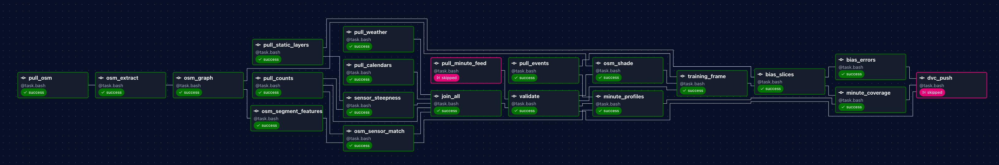
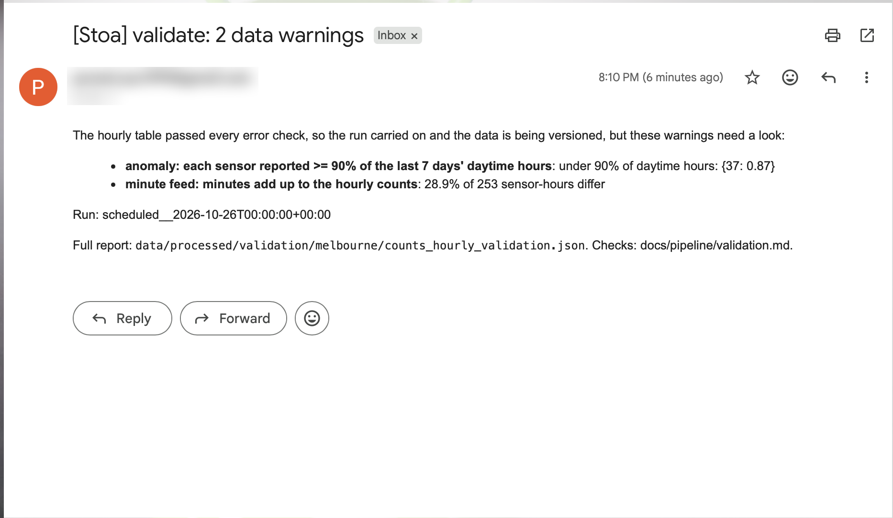
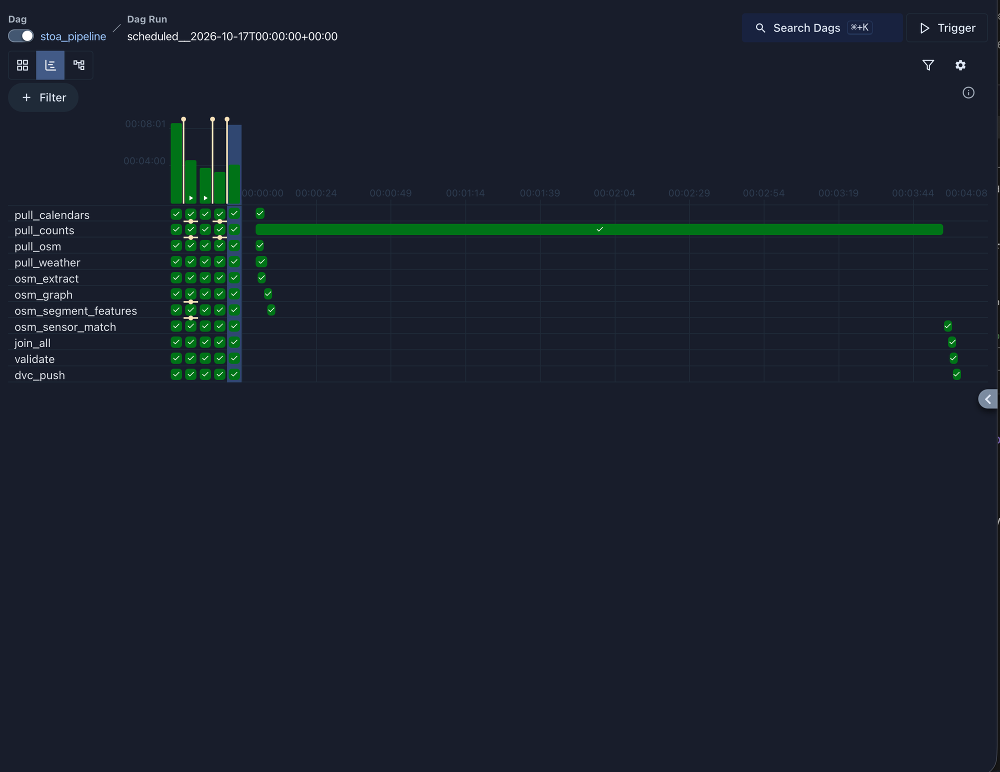
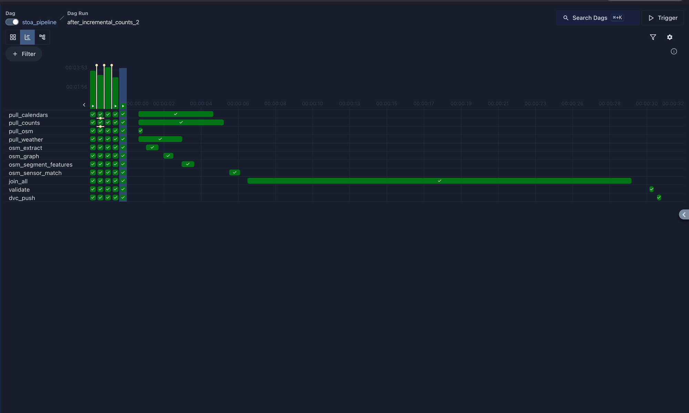
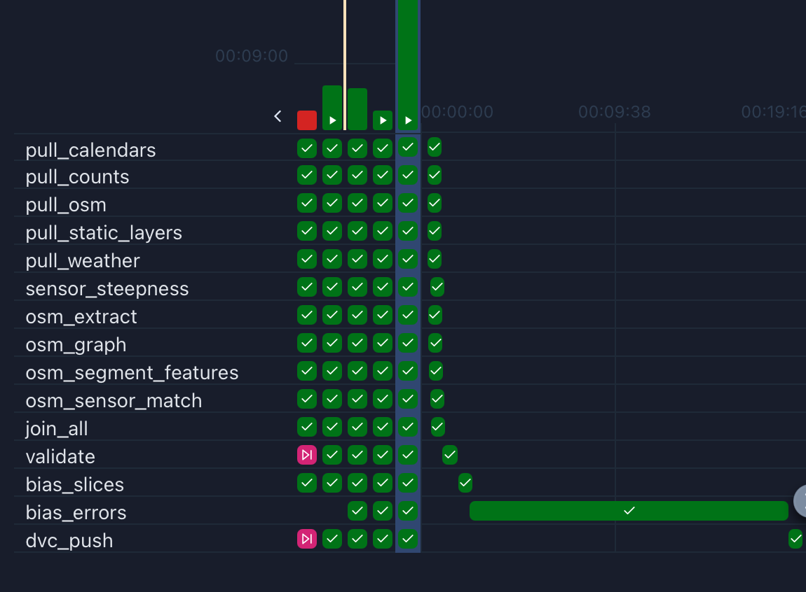
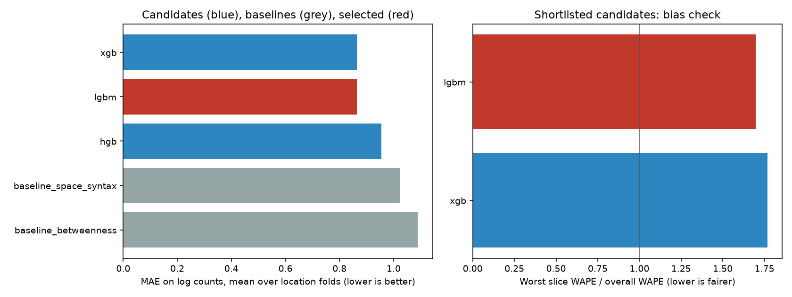
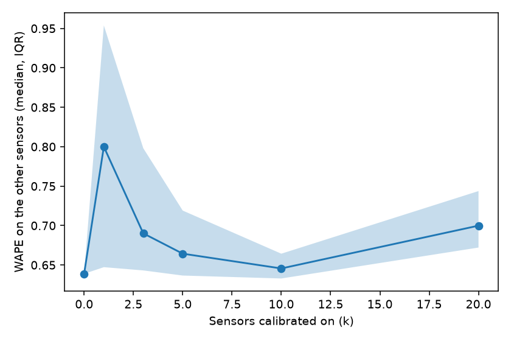
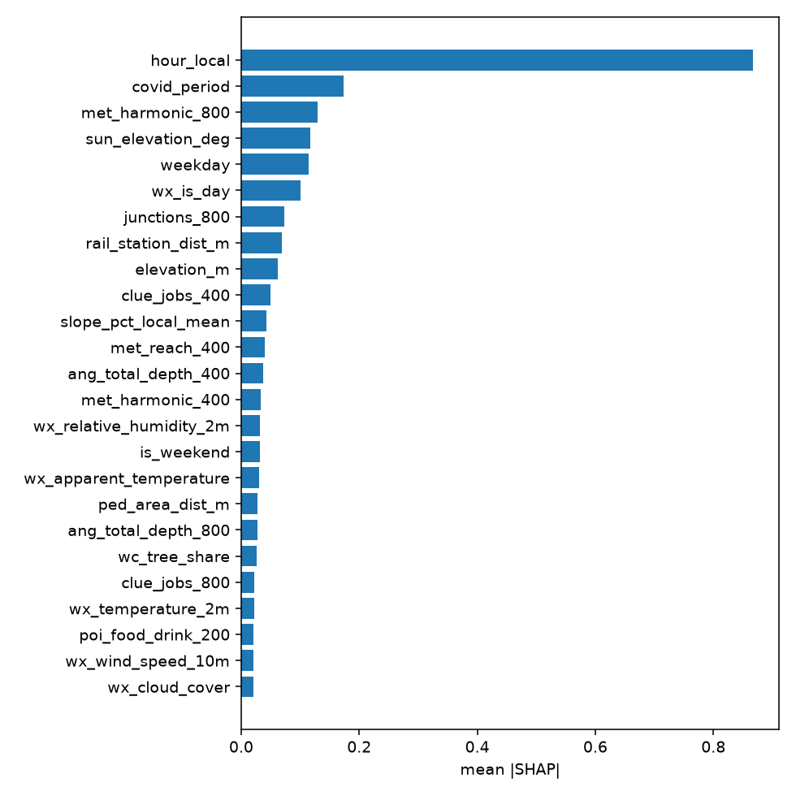
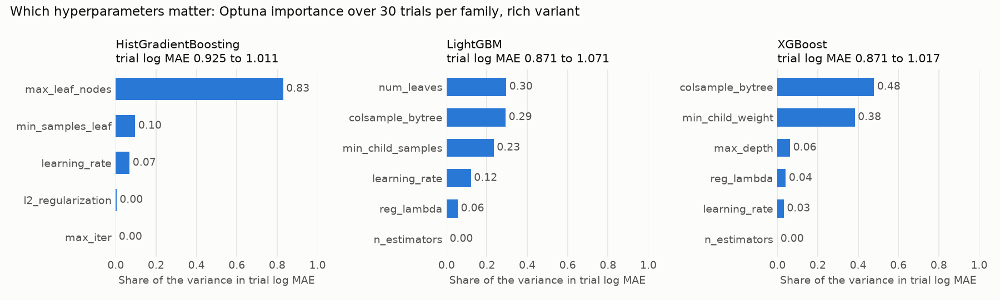
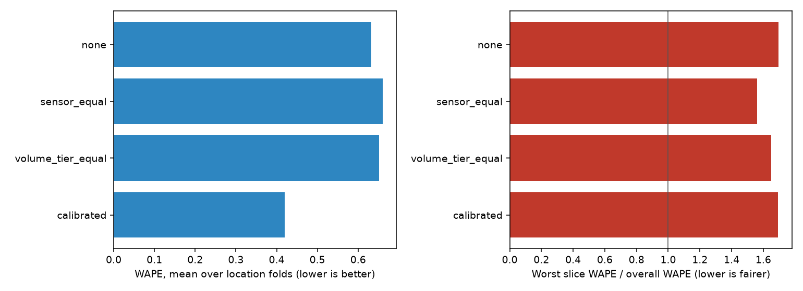

# Stoa

Stoa predicts where people walk, how many, and when, on every path of a site. Planners can test a change ("close this path", "add an entrance", "it's game day") before building it, and store owners can see the hourly pass-by at a candidate storefront and how many of those people can see it.

We train on the City of Melbourne's pedestrian sensors: 118 sensors, hourly counts from 2009 to today, 7.4 million sensor-hours. This repo holds two pipelines, both run by Airflow in Docker:
- **The data pipeline** (`stoa_pipeline`) pulls those counts and everything around them (weather, calendars, the street network, terrain), turns them into one clean hourly table, checks it, measures bias in it, and versions it.
- **The model pipeline** (`stoa_train`) trains the flow model on that versioned data, picks the best candidate on accuracy and bias, validates it on sensors and whole precincts it never saw, checks it against gates, and registers it in MLflow with promotion and rollback. See [The model pipeline](#the-model-pipeline).

IE7374 MLOps, Northeastern University, Fall 2026. *Formerly DesireLine.*

**Team:** Romit Basak · Arshmehar Kaur · Bimbasri Paduru · Puneet Singh Puri · Shubham Madhusudan Hadawle

## Where each requirement lives

### Data pipeline

| Course requirement | Where to look |
|---|---|
| Data acquisition | `src/ingest/`, sources listed in `configs/data.yaml`. See [Running steps by hand](#running-steps-by-hand) |
| Preprocessing and features | `src/features/`. Steps in [Preprocessing](#preprocessing); the hourly table is described in [docs/features/counts_hourly.md](docs/features/counts_hourly.md), the street features in [docs/features/osm_features.md](docs/features/osm_features.md) and [docs/features/segment_context.md](docs/features/segment_context.md), and the training frame in [docs/features/training_frame.md](docs/features/training_frame.md). Every column is declared in `src/features/schema.py` |
| Airflow DAG | `dags/stoa_pipeline.py`, plus four smaller DAGs. See [The pipeline](#the-pipeline) |
| Data versioning (DVC) | `data/*.dvc`, `dvc.yaml`, `dvc.lock`. See [Data versioning with DVC](#data-versioning-with-dvc) |
| Schema and statistics | `src/pipeline/validate.py`, `configs/schemas/counts_hourly.yaml`. See [Validation, anomalies and alerts](#validation-anomalies-and-alerts) |
| Anomaly detection and alerts | Same section; every check is listed in [docs/pipeline/validation.md](docs/pipeline/validation.md) |
| Logging and error handling | [Logging and error handling](#logging-and-error-handling) |
| Bias detection and mitigation | `src/bias/`. Summary in [Bias detection and mitigation](#bias-detection-and-mitigation), full write-up in [docs/bias/bias_slicing.md](docs/bias/bias_slicing.md) |
| Pipeline optimization (Gantt) | [Pipeline optimization](#pipeline-optimization) |
| Tests | `tests/`, which mirrors `src/`; CI in `.github/workflows/`. See [Tests and lint](#tests-and-lint) |
| Reproducibility | [Quickstart](#quickstart) |
| Folder structure | [Repository layout](#repository-layout) |
| Code style (PEP 8) | `pyproject.toml` (ruff settings). See [Tests and lint](#tests-and-lint) |

### Model pipeline

Numbers in the first column are the sections of the model development guidelines.

| Course requirement | Where to look |
|---|---|
| 2.1, 8.2 Loading data from the data pipeline | `src/models/flow/data.py`. See [Loading the data](#loading-the-data) |
| 2.2, 8.3 Training and selecting the best model | `src/models/flow/train.py`, `candidates.py`, `baselines.py`, `select.py`. See [Models, and how the best one is chosen](#models-and-how-the-best-one-is-chosen) |
| 2.3, 8.4 Validation on held-out data | `src/models/flow/evaluate.py`, `select.py`. See [Validation](#validation) and [Results](#results) |
| 2.4, 2.5, 6.1, 6.2, 8.5 Bias detection with slicing (Fairlearn), and the code that checks it | `src/models/flow/select.py` (`bias_check`), slices from `src/bias/slices.py` and `configs/bias.yaml`. See [Bias in the model](#bias-in-the-model) |
| 6.3, 6.4 Bias mitigation, documented with its trade-offs | `src/models/flow/mitigate.py`; [docs/bias/model_bias.md](docs/bias/model_bias.md) |
| 8.6 Model selection after the bias check | `select.py` (`select_variant`). See [Models, and how the best one is chosen](#models-and-how-the-best-one-is-chosen) |
| 2.6, 8.7 Pushing the model to a registry | `src/models/flow/registry.py`, `bundle.py`: the MLflow model registry, which on the team's GCP VM keeps its model files in Cloud Storage. See [Registry, promotion and rollback](#registry-promotion-and-rollback) |
| 3 Hyperparameter tuning (search space and process) | `src/models/flow/tune.py`. See [Hyperparameter tuning](#hyperparameter-tuning) |
| 4 Experiment tracking | `src/models/tracking.py` and the `mlflow` service. See [Experiment tracking](#experiment-tracking) |
| 4 Results and model selection charts | [Results](#results); charts in `docs/models/figures/` |
| 5 Sensitivity analysis (SHAP, hyperparameters) | `select.py` (`importance`), `tune.py`. See [Sensitivity analysis](#sensitivity-analysis) |
| 7.1 Training triggered by a code push | `.github/workflows/train.yml` starts `stoa_train` (`dags/stoa_train.py`) on the GCP VM on a push to main that changes the model code, monthly, or by hand. See [CI/CD and notifications](#cicd-and-notifications) |
| 7.2, 7.3 Automated validation and bias check that block a bad model | `check_gates` in `stoa_train` (`registry.py --check`) |
| 7.4 Automated registry push | `register_model` in `stoa_train` (`registry.py --promote`) |
| 7.5 Notifications | `notify_team` in `stoa_train` (`src/models/flow/notify.py`): an email with the result of every run, the gate's reasons when it fails, and a failure email from any failed task. See [CI/CD and notifications](#cicd-and-notifications) |
| 7.6 Rollback | `registry.py`: a retrain worse than the champion is never promoted, and `--rollback` restores earlier versions. See [Registry, promotion and rollback](#registry-promotion-and-rollback) |
| 8.1 Docker | `Dockerfile` and `docker-compose.yaml`: both DAGs and the MLflow server run in containers. See [Running it](#running-it) |

## Quickstart

Give Docker at least 8 GB of memory (Docker Desktop → Settings → Resources). You don't need any credentials: every input comes from public sources, so the first run downloads and builds everything itself.

```bash
git clone https://github.com/romit-basak/Stoa.git && cd Stoa
echo "AIRFLOW_UID=$(id -u)" >> .env    # Linux only, so the containers can write to data/
docker compose up -d --build           # the first build takes a few minutes
```

Open http://localhost:8080 (no login locally) and unpause `stoa_pipeline`. On a fresh clone, unpausing starts the first run by itself, so there's no need to press Trigger (a Trigger would queue a second run behind it); use Trigger for later runs. When you're done, run `docker compose down` (add `-v` to also wipe Airflow's database).

**How long it takes.** The first run takes about 22 minutes (measured on a clean clone on 25 October 2026: about 6 minutes to download and build the data, then 16 for `bias_errors`). Most of that is `bias_errors` (about 16 minutes, because it trains 15 models), pulling the counts (including a 171 MB copy from the Internet Archive, which is often slow), and building the street network once. Later runs reuse what's already there and take about 2 minutes; `bias_errors` retrains only once a week. A task that runs for several minutes isn't stuck: click it, then Logs, to watch its progress. Don't mark it as success to move on: Airflow stops a running task when it's marked, so its results are never written.

**Training the model.** Once `stoa_pipeline` has finished its first run, unpause and trigger `stoa_train` (an hour or more; see [The model pipeline](#the-model-pipeline)). Its runs and registered models appear in MLflow at http://localhost:5001, which `docker compose up` also starts.

**What you'll see without credentials.** `pull_minute_feed` and `dvc_push` need access to the team's bucket, so on your machine they show as skipped (pink). The run still succeeds and no failure email goes out. Leave the second DAG, `stoa_minute_feed`, paused: it only feeds the team's per-minute archive.

The repo is mounted into the containers, so code changes apply on the next run. Changes to dependencies in `pyproject.toml` need `docker compose up -d --build`. Data is written to `data/` on your machine.

## Setup for local development

To run modules or tests outside Docker, you need Python 3.11+ and [uv](https://docs.astral.sh/uv/):

```bash
uv venv .venv
uv pip install --python .venv/bin/python -e ".[dev]"
```

On macOS, LightGBM and XGBoost also need the OpenMP runtime: `brew install libomp` (without it, their tests fail with `Library not loaded: @rpath/libomp.dylib`, and on some setups `tests/models/test_flow_mitigate.py` crashes when the whole file runs). Linux and the Docker image don't need it.

Without uv, `pip install -r requirements.txt` (Python 3.11) installs the exact versions we tested with. `pyproject.toml` is the source of truth. After changing its dependencies, regenerate the pins with `uv pip compile pyproject.toml --extra dev --python-version 3.11 -o requirements.txt`.

## The pipeline

One Airflow DAG, `stoa_pipeline` (`dags/stoa_pipeline.py`), runs the Melbourne pipeline in Docker every day. It runs daily to keep the table current; if a day is missed, the next run picks it up. Each task runs one module from `src/` exactly as you would by hand.

```
pull_counts ──────────────────────────────────────────────────────────────────────┐
pull_osm ─► osm_extract ─► osm_graph ─► osm_segment_features ─► osm_sensor_match ─┤
pull_static_layers ─► sensor_steepness ───────────────────────────────────────────┤
pull_weather ─────────────────────────────────────────────────────────────────────┼─► join_all ─┐
pull_calendars ───────────────────────────────────────────────────────────────────┘             ├─► validate
pull_minute_feed ───────────────────────────────────────────────────────────────────────────────┘

validate ─┬─► osm_shade ─► training_frame ─► bias_slices ─┬─► bias_errors ──────┐
          │                                               │                     ├─► dvc_push
          └─► minute_profiles ────────────────────────────┴─► minute_coverage ──┘
```

`pull_counts` also feeds `osm_sensor_match` and `sensor_steepness`, which need the sensor locations, and `pull_static_layers` also feeds `bias_slices`. `osm_graph` also feeds `osm_shade`, which waits for `validate` so that on a first run it doesn't build (about 3 minutes) while the hourly table is in memory. `pull_events` (AFL games) also feeds `training_frame`; `pull_events` and `osm_sensor_match` also feed `minute_profiles`.

The same DAG in Airflow's graph view, after a run on 5 November 2026 (3 min 11 s). The data was the committed version (what `dvc pull` fetches), so the street-network and shade steps found their outputs up to date, and `bias_errors` had retrained earlier that day, so it wasn't due. The containers had no `.env` or `.secrets/`, so `pull_minute_feed` and `dvc_push` skipped (pink) as described in the [Quickstart](#quickstart); every other task succeeded.



| Task | What it does |
|---|---|
| `pull_counts` | Hourly counts and sensor locations from the City of Melbourne portal |
| `pull_weather` | Hourly weather (ERA5 via Open-Meteo) |
| `pull_calendars` | Public holidays, plus the school and university terms kept in `configs/calendars/` |
| `pull_static_layers` | Footpath-steepness survey, 5 m terrain model and CLUE areas (the City's precincts), each fetched only if it isn't already on disk |
| `pull_events` | AFL crowds (AFL Tables) and fixtures (Squiggle) for the current season and any season not held, one page each |
| `pull_osm`, `osm_*` | The OpenStreetMap extract, the walking graph, per-segment features (network metrics, amenities, transit, land cover, slope, canopy, jobs, event venues), building shade for each sun position, and each sensor's matching segment |
| `sensor_steepness` | Footpath slope and elevation at each sensor |
| `pull_minute_feed` | Copies the per-minute counts archive from the bucket into `data/raw` |
| `join_all` | Builds the hourly table, `counts_hourly.parquet`: one row per sensor and hour, with time, weather, calendar, slope and street features |
| `validate` | Checks the table's schema, values, anomalies and drift. Fails the run on errors |
| `training_frame` | The rows, features and location splits every model trains from, with each feature's reference distribution for drift checks |
| `bias_slices` | How much data each group (place, time, weather, era...) has |
| `bias_errors` | A baseline model's error for each group, with and without mitigations. Retrains weekly |
| `minute_profiles` | How people spread across each hour in 5-minute blocks, from the per-minute archive |
| `minute_coverage` | Which groups the per-minute profiles under-cover, and the pooled profiles that fix it |
| `dvc_push` | Saves the result as a new DVC version |

How it's set up:
- Each task retries twice, five minutes apart. The exception is `validate`: bad data fails the same way every time, so retrying would only delay the alert.
- `validate` runs even when `pull_minute_feed` is skipped, but not when an earlier task fails.
- `catchup` is off, because the next run's merge covers a missed day. Only one run goes at a time, since two would write the same files.
- The bias tasks run after `validate`, so they only see data that passed. Running them side by side also ran out of memory (see [Pipeline optimization](#pipeline-optimization)).

What a daily run re-does:
- **Counts:** only the days from two before the latest date we hold, merged into the rows we already have on (location, date, hour). The fixed 2009–2022 archive is kept. To re-fetch everything: `python -m src.ingest.melbourne_portal --only pedestrian-counting-system-monthly-counts-per-hour --full`.
- **Weather:** only the last two years (`--full` re-fetches all of it).
- **OpenStreetMap:** the extract is pinned. Each OSM stage skips itself unless one of its inputs changed: the extract, `configs/features.yaml`, the code in `src/features/`, the sensor locations, or `configs/sensor_overrides.yaml`. Settings and code that only later steps read (the hourly table, the training frame, the minute profiles) don't count. A skipped OSM chain takes a couple of seconds.
- **AFL games:** only the current season, one page from each source.

To move to a newer OSM extract, trigger the DAG with `refresh_osm` set to true (Trigger, then advanced options). That renumbers the graph's segments, so `osm_sensor_match` fails until any sensor overrides that point at old segments are fixed.

### Other DAGs

| DAG | When | What |
|---|---|---|
| `stoa_train` | Triggered (set `tune` for the Optuna search); on the team VM by GitHub Actions on a push to model code and monthly | Trains, selects, checks, registers and reports the flow model on the data `stoa_pipeline` last built. See [The model pipeline](#the-model-pipeline) |
| `stoa_site_build` | Triggered, with `site` | A site's graph and features without counts: NEU Boston (the demonstration) and NYC (the transfer test, clipped around its 114 count locations). See [docs/pipeline/site_build.md](docs/pipeline/site_build.md) |
| `stoa_minute_feed` | Every 15 minutes | Archives the per-minute counts into the bucket (see [The per-minute counts](#running-steps-by-hand)); leave it paused unless you poll for the team |
| `stoa_osm_watch` | Weekly | Reports OSM path changes near the sensors since the pinned extract, without replacing it |

## Preprocessing

`join_all` (`src/features/counts_hourly.py`) turns the downloads into the hourly table, one row per sensor and hour. In order:

1. **One source per hour.** The counts come from three copies of the City's table: the 2009–2022 archive, the live table (a rolling window of about two years) and an Internet Archive copy of the portal's export, which fills November 2022 to October 2024. Each hour is taken from exactly one of them, the Internet Archive copy only where neither of the others has it. The live table is merged into the rows already held, never overwritten, because the portal drops its oldest rows.
2. **Cleaning.**
   - In September 2010 the archive stamps every hour as midnight. The rows are still in hour order, so each sensor-day's 24 rows are renumbered 0–23 (12,240 rows).
   - Any other duplicate sensor-hour is dropped and counted.
   - The archive has rows for the hour the clocks skip each October; they're dropped (370 rows).
   - The 18 retired sensors get their locations from the October 2022 copy of the sensor table.
   - A run of 3 or more zero hours that reaches into the daytime is flagged `suspect_outage_zero`, since it's more likely a sensor fault than an empty street. Missing hours stay missing and are never filled with zeros.
3. **Time.** Hour, weekday and every calendar column use Melbourne's local clock, daylight saving included, because people follow the clock. Weather is joined on UTC (Open-Meteo's files are fixed at UTC+10 all year), and sun elevation is computed for the middle of each hour.
4. **Features.** Weather (ERA5), public holidays, school and university terms, footpath slope and elevation per sensor (`sensor_steepness`), and the street features of each sensor's OSM segment (`osm_sensor_match`).

The street features come from the OSM steps (`src/features/osm.py`, run as `osm_extract`, `osm_graph`, `osm_segment_features` and `osm_sensor_match`). The walkable network is split into segments, with edges added across plazas and crossings inferred where OSM maps sidewalks apart from the road; entrances join a separate routing graph. Each segment gets network metrics at 400, 800 and 1,600 m, counts of amenities within 100–400 m along the network, the network distance to the nearest tram stop, bus stop and train station, opening hours by hour of the week, land cover, slope, canopy and jobs nearby, and building shade for each sun position (`osm_shade`).

`training_frame` (`src/features/training_frame.py`) then joins the hourly table, the segment features, the shade for each hour's sun position and the event features (AFL games from `pull_events` and the sourced log in `configs/events.yaml`) into what every model trains from, with the location splits ([docs/features/training_frame.md](docs/features/training_frame.md)).

Each step is its own function or module with its settings in `configs/features.yaml`, so a step can be changed or rerun on its own ([Running steps by hand](#running-steps-by-hand)). `validate` checks the hourly table before the training frame is built. The column dictionaries and the reasoning behind each step are in [docs/features/counts_hourly.md](docs/features/counts_hourly.md), [docs/features/osm_features.md](docs/features/osm_features.md) and [docs/features/segment_context.md](docs/features/segment_context.md); every column is declared in `src/features/schema.py`.

## Data versioning with DVC

Data isn't in git. DVC versions `data/raw`, `data/interim` and `data/processed` as whole folders and stores them in the `gs://stoa-dvc-data` bucket on the team's GCP project. Git holds only the pointer files (`data/*.dvc`) and `dvc.lock`.

**Getting the team's data** needs access to the bucket (ask Romit):

```bash
gcloud auth application-default login   # once, with the account added to the project
.venv/bin/dvc pull                      # downloads data/ at the version this commit points to
```

No access? Skip this. The first Airflow run builds the same data from public sources, and it covers the same years as ours plus whatever the portal has published since.

**Every good run becomes a version.** The last task, `dvc_push` (`src/pipeline/dvc_push.py`), runs `dvc add` on the three folders, `dvc commit` to record each stage's inputs in `dvc.lock`, then `dvc push`. It runs after `validate`, so only data that passed the checks is versioned. It doesn't commit to git: when the data changed, its log ends with the `git add data/*.dvc dvc.lock && git commit` command to run. Until someone commits those files, teammates' `dvc pull` still fetches the previous version.

To make a version by hand after changing data:

```bash
.venv/bin/dvc add data/raw data/interim data/processed
.venv/bin/dvc commit --force dvc.yaml   # record each stage's inputs in dvc.lock
.venv/bin/dvc push
git add data/*.dvc dvc.lock && git commit -m "..."
```

**Stages (`dvc.yaml`).** There's one stage per Airflow task, with its command and inputs: its code, configs and the data it reads. `dvc.lock` records the exact version of every input, so any data version can be traced back to the code and settings that produced it.

```bash
.venv/bin/dvc status   # which stages' inputs changed, e.g. "validate: changed deps: modified: configs/validation.yaml"
.venv/bin/dvc dag      # the stages
```

Don't use `dvc repro`; run the pipeline with Airflow. The stages list no outputs, because DVC doesn't allow a stage output inside a folder that's tracked as a whole, so DVC can't work out the order on its own. The download stages always show as changed, since they fetch new data on every run.

**Protecting the bucket.** Soft delete keeps a deleted object for 7 days, and object versioning (on since 25 October 2026) keeps up to 3 older versions of each file for 30 days, since the per-minute archive rewrites its day files every 15 minutes. A project owner set it up with:

```bash
gcloud storage buckets update gs://stoa-dvc-data --versioning
cat > /tmp/stoa-lifecycle.json <<'JSON'
{"rule": [
  {"action": {"type": "Delete"}, "condition": {"isLive": false, "numNewerVersions": 3}},
  {"action": {"type": "Delete"}, "condition": {"isLive": false, "daysSinceNoncurrentTime": 30}}
]}
JSON
gcloud storage buckets update gs://stoa-dvc-data --lifecycle-file=/tmp/stoa-lifecycle.json
gcloud storage buckets describe gs://stoa-dvc-data --format="yaml(versioning_enabled,lifecycle_config)"   # check
```

Count days that have left the portal's window, the pinned OSM extracts and the validation history exist only in our copies. Where a second copy should live is still a team decision.

**Credentials for `dvc_push`.** The containers log in to the bucket as the `stoa-airflow-dvc` service account, using a key file in `.secrets/` (git-ignored; each person makes their own). Once, with `gcloud` signed in to an account on the project:

```bash
mkdir -p .secrets
gcloud iam service-accounts keys create .secrets/stoa-airflow-dvc.json \
  --iam-account=stoa-airflow-dvc@stoa-511822.iam.gserviceaccount.com
```

Without that key, `dvc_push` falls back to your `gcloud auth application-default login`, then to the service account of a Google Cloud VM. With no credentials at all it's skipped, with a warning in its log. On team machines, add `STOA_REQUIRE_DVC_PUSH=1` to `.env`: then a missing key fails the task and sends the failure email instead.

## Validation, anomalies and alerts

`validate` (`src/pipeline/validate.py`) checks the hourly table after `join_all` builds it and before anything is versioned. It uses a Great Expectations suite for the column checks and our own code for the anomaly checks:
- **Schema:** the columns and their types match `configs/schemas/counts_hourly.yaml`, which is generated from `src/features/schema.py`, where every column is declared with its type, role and whether it transfers to other cities. When we add a feature, we declare it there, run `python -m src.features.schema --write` and commit both; `validate --schema-diff` shows how a table differs.
- **Values:** one row per sensor-hour; no missing values except where documented; values in physical ranges; categories from an allowed list.
- **Anomalies:** new per-sensor outliers, stuck sensors, gaps in the last week's daytime hours, stale data, and too many outage zeros.
- **Drift:** row count, sensor count, missing values and mean count compared with the last good run, and each feature's distribution against the training frame's reference (population stability index).
- **The per-minute archive:** missing days, late polls, duplicate rows, sensors that never publish part of the hour, and minutes that don't add up to the hourly counts.

**Statistics over time.** Every run writes a statistics profile of each column and a report of every check to `data/processed/validation/melbourne/`. Each good run adds a summary line to a history file, and the next run's drift checks compare against it. A failed run doesn't join the history, so bad data never becomes the baseline. These files sit under `data/processed/`, so DVC versions them with the data they describe.

**Errors and warnings.**
- **Errors** (a broken schema, duplicate or negative counts, lost rows) fail the task without retrying. The team gets the failure email, and `dvc_push` doesn't run, so bad data never becomes a version.
- **Warnings** (a new outlier, a quiet sensor, stale data) are logged as `WARN` lines and emailed to the team, and the run carries on. All per-minute checks are warnings.

The warning email from the run of 26 October 2026 (`scheduled__2026-10-26`): sensor 37 reported only 87% of its daytime hours in the last week, and the per-minute archive's minutes didn't add up to the hourly counts for 28.9% of sensor-hours. That second warning was the archive's partial first hour (it began at 00:55 on 25 October), which the check now leaves out. The run carried on and versioned the data. The sender's address is blurred.



Thresholds are in `configs/validation.yaml`. [docs/pipeline/validation.md](docs/pipeline/validation.md) describes every check and how we tested each one against planted errors.

**Setting up the alert emails.** When a task fails after its last retry, Airflow emails the team the task, the run and a link to the log. Validation warnings use the same settings. They live in `.env` in the repo root, which is git-ignored; without it, alerts are off. The sender needs a Gmail [App Password](https://myaccount.google.com/apppasswords) (this requires 2-Step Verification), not the account password:

```bash
STOA_SMTP_USER=you@gmail.com
STOA_SMTP_PASSWORD=abcdefghijklmnop          # 16-character App Password, no spaces
STOA_ALERT_EMAILS=a@northeastern.edu,b@northeastern.edu
```

Run `docker compose up -d` after editing `.env` to apply it.

## Logging and error handling

- Every module logs with Python's `logging` (set up once in `src/ingest/common.py`): each download with its size, retries, skipped steps and row counts.
- In Airflow, open a run, click a task and choose Logs. The same logs are written to `logs/` in the repo (git-ignored), one folder per DAG, run and task, so you can read or `grep` them without the UI. For example: `logs/dag_id=stoa_pipeline/run_id=<run>/task_id=pull_counts/attempt=1.log`.
- Every download writes a `MANIFEST.json` next to its files, with the URL, SHA-256, retrieval time and license.
- `download()` retries rate limits, server errors, dropped connections, timeouts, and empty or cut-short files, with backoff. It writes to a `.part` file first, so a failed download never replaces the last good copy. If every try fails, it raises `DownloadError` naming the URL. The task then fails, Airflow retries it twice, and the failure email links to the log.
- Without bucket credentials, `pull_minute_feed` and `dvc_push` exit with code 99, which Airflow treats as a skip rather than a failure.

## Bias detection and mitigation

Our data has no people in it. The counts are anonymous totals per sensor and hour, so there's no age or gender to slice on, by design. For a pedestrian model, the groups that can be served worse are places, times and conditions: a model trained mostly on busy city-centre streets in fine weather can look accurate overall and still be poor on a quiet street, at night or in the rain.

We slice the hourly table 20 ways, including precinct, how busy the sensor is, nearby amenities, slope, time of day, holidays, rain, temperature, era (before, during and after COVID) and AFL match days. The slices are defined in `configs/bias.yaml`.

1. **How much data each group has** (`bias_slices`). Each group's share is compared with a fair reference: hours in the study period for time and weather, walkable network for precincts, and footpath length for slope. Place is the most uneven: the city centre has five times its share of sensors, while Carlton, North Melbourne, Parkville and Kensington have about a third of theirs or less.
2. **Where a model does worse** (`bias_errors`). A gradient-boosting baseline stands in for the flow model here, so the data stage doesn't depend on it; the flow model's own check, mitigation and gate are in [Bias in the model](#bias-in-the-model) and [docs/bias/model_bias.md](docs/bias/model_bias.md). It's trained in 5 folds with whole sensors held out (since 15 November, whole spatial groups, which raises the overall WAPE to 0.60 and clears Kensington; the rest of the picture holds). We measure its relative error (WAPE) per group with Fairlearn's `MetricFrame`, with 95% intervals from resampling sensors. On the run of 25 October, which the write-up describes, overall WAPE is 0.53. Nine groups are clearly worse, including quiet sensors, sensors with few amenities nearby, Southbank, night and late evening, public holidays and the COVID era. Most thin outer precincts are not, apart from Kensington's 2 sensors.
3. **Mitigation.** Reweighting the training rows (two ways) didn't lower the overall error and moved error from some weak groups onto others, so we rejected it. Calibrating each sensor to four weeks of its own counts cut the overall error by about 30% (WAPE 0.53 to 0.38) and fixed the quiet, low-amenity, Southbank and Kensington sensors. Night and COVID are still worse: their error is in the shape of the pattern, which needs changes to the model, not the weights. The rerun on 5 November, with eleven more days of counts, gave 0.53 before calibration and 0.37 after.
4. **The per-minute data** (`minute_coverage`). The same slices showed the per-minute profiles under-cover quiet hours, so quiet hours are pooled by volume tier. On the run of 13 November (18 days of minutes) that raised coverage from 71% to 92% of sensor-hours (quiet sensors from 60% to 97%, night from 33% to 92%). Carlton and Parkville stay the least covered (63% and 65%), because three of their sensors never publish the first 5 minutes of each hour.

[docs/bias/bias_slicing.md](docs/bias/bias_slicing.md) has every number, the trade-offs we accepted, and the next steps.

## Pipeline optimization

We used Airflow's Gantt chart (open a run, then Gantt) to find the slow tasks, and made three changes.

**1. Download only the new counts.** The first Gantt chart showed `pull_counts` taking 229 of the run's 234 seconds. Everything after the OSM chain waited for it, because it re-downloaded the whole two-year table (1.6M rows) and the 42 MB 2009–2022 archive every day just to add one day. It now asks the portal only for rows from two days before the latest date we hold (the portal fills in the current day hour by hour, and older rows don't change).

| Task | Before (s) | After (s) |
|---|---|---|
| `pull_counts` | 229.3 | 5.0 |
| Other ingest tasks | 7.1 | 7.2 |
| OSM stages (skipped, inputs unchanged) | 2.9 | 2.6 |
| `join_all` | placeholder | 22.5 |
| **Whole run** | **233.6** | **31.5** |

| Before (run of 2026-10-17 00:00 UTC) | After (run `after_incremental_counts_2`) |
|---|---|
|  |  |

Along the way we found that the portal's `id` isn't unique. It glues together location, hour and date, so location 4 at hour 20 and location 42 at hour 2 share an id. Merging on it had silently dropped about 4.5% of rows. We now merge on (location, date, hour).

**2. Run `validate` and `bias_slices` one after the other.** They used to run side by side. Once the table reached 7.4M rows, together they needed about 7.7 GB (`validate` 3.3 GB, `bias_slices` 2.9 GB, plus about 1.5 GB for Airflow). That's more than Docker Desktop's default 8 GB can give, and `validate` was killed on a fresh-clone run. In sequence the peak is about 5 GB, and each task runs close to its solo time because they no longer compete for CPU.

**3. Speed up Great Expectations.** Profiling `validate` showed the Great Expectations suite was most of it: about 28 s, against 6 s for every other check together and 1 s to read the table. Two things in GX 1.x made it slow: its fast range check only runs on columns that are exactly `int64` or `float64` (ours are `int8`, `int32` and `float32`, so it fell back to a Python call per row), and before each check it copied the whole frame. Now each expectation gets a frame with just its own columns, widened to 64-bit. The suite takes 17 s instead of 28 and peaks at 3.9 GB instead of 5.0, with the same results (`run_expectations` in `src/pipeline/validate.py`).

**The pipeline today.** Two runs on 25 October 2026 (7,416,763 rows, Docker Desktop's default 8 GB, every task green on its first try) show a normal day and a day when `bias_errors` retrains:

| Task | Daily run (`bias_errors` skipped) | Weekly run (`bias_errors` trains) |
|---|---|---|
| `bias_errors` | 1 s | 950 s |
| `validate` | 41 s | 47 s |
| `join_all` | 40 s | 34 s |
| `bias_slices` | 29 s | 32 s |
| `pull_counts` | 6 s | 6 s |
| `dvc_push` | 4 s | 6 s |
| Other ingest and OSM tasks (OSM skipped) | 3 s or less each | 3 s or less each |
| **Whole run** | **127 s** | **1,081 s** |



A daily run takes about 2 minutes. Once a week, `bias_errors` adds about 16 minutes and is the whole bottleneck. That's fine for a weekly fairness report. If it needs to be faster, the next step is fewer folds or mitigations per run, or giving it a schedule of its own. These runs came before the minute, shade, event and training-frame tasks were added. On 5 November 2026, with all of them, a daily run took 3 min 11 s: `join_all` 49 s, `validate` 47 s, `training_frame` 32 s, `bias_slices` 31 s, and a few seconds for each of the others.

## The model pipeline

The flow model predicts the hourly pedestrian count on a path segment, with an 80% interval. It trains on the Melbourne sensors and can predict any segment that has features, so it covers the whole network, not only the sensors. It has to work on sensors and precincts it has never seen, so every score comes from whole sensors held out, never from held-out hours of a sensor it trained on. The code is in `src/models/flow/`, the settings in `configs/models.yaml` (`flow`), and the full method in [docs/models/flow_model.md](docs/models/flow_model.md).

A second Airflow DAG, `stoa_train` (`dags/stoa_train.py`), runs it in the same Docker image as the data pipeline, on the training frame that `stoa_pipeline` last built. On the team's GCP VM, GitHub Actions starts it on a push to main that changes the model code and once a month ([CI/CD and notifications](#cicd-and-notifications)); anyone can also trigger it by hand. The daily data pipeline never trains.

```
train_candidates ─► select_model ─► mitigate_bias ─► check_gates ─► register_model ─► notify_team
```

| Task | Module | What it does |
|---|---|---|
| `train_candidates` | `train.py` (and `tune.py`) | Loads the training frame, then trains the two baselines and three model families, each in two feature sets, on the location folds. Every model goes to MLflow with its out-of-fold predictions. With `tune` set, an Optuna search per family runs first; otherwise it reuses the parameters of the last run, or the first time those in `configs/models.yaml` |
| `select_model` | `select.py` | Checks the near-best candidates for bias and picks the fairest, fits its 80% interval, fits it on every fold sensor, scores the holdout precincts for the first time, and logs the result with charts, a report and the model bundle |
| `mitigate_bias` | `mitigate.py` | Retrains the selected model with reweighted rows, and calibrates it, scored on the same slices and hours |
| `check_gates` | `registry.py --check` | Fails the run, and emails the reasons, if the model doesn't beat Space Syntax by 10%, its intervals miss 75 to 85% coverage, or one slice's error is over 2.25 times the overall |
| `register_model` | `registry.py --promote` | Registers the model in the MLflow model registry and makes it `champion`, unless the current champion is better |
| `notify_team` | `notify.py` | Emails the team what was registered, each variant's metrics, and whether the champion changed |

### Running it

```bash
docker compose up -d --build        # Airflow (http://localhost:8080) and MLflow (http://localhost:5001)
```

In Airflow, trigger `stoa_train` after `stoa_pipeline` has built the training frame (set `tune` to true for the Optuna search). On the team's GCP VM, `ops/vm/vm.sh train` (add `--tune` for the search) does the same as the CI job: deploy main, then trigger the DAG. `ops/vm/vm.sh tunnel` opens the VM's Airflow and MLflow at the same local addresses. Or run the steps by hand:

```bash
.venv/bin/python -m src.models.flow.train            # --tune for the search, --seed to change the seed
.venv/bin/python -m src.models.flow.select
.venv/bin/python -m src.models.flow.mitigate
.venv/bin/python -m src.models.flow.registry --check     # then --promote, or --rollback --variant rich
```

On an Apple M4 laptop (10 cores, 16 GB), for both variants: `train` takes about 21 minutes (73 with `--tune`), `select` 16 to 19, `mitigate` 16 to 18, and the gate a few seconds. A `stoa_train` run takes about an hour, or close to two with tuning.

### Loading the data

`src/models/flow/data.py` loads the training frame that `stoa_pipeline` built and DVC versioned (`training_frame`, [docs/features/training_frame.md](docs/features/training_frame.md)). That frame has the located outdoor sensors with outage hours dropped, the features declared in `src/features/schema.py`, and the location splits, so the model gets exactly the pipeline's transformations and never redoes them. Every MLflow run is tagged with the DVC version of `data/raw`, `data/interim` and `data/processed` and with the frame's spec (input hashes, OSM extract, row and sensor counts). A run can therefore be traced to its exact data (`git checkout` the commit, then `dvc checkout`), and the gate only compares runs on the same data version.

### Models, and how the best one is chosen

| Model | What it is |
|---|---|
| `baseline_betweenness` | Shortest-path betweenness at 1,600 m, calibrated to counts: rung 1 of the baseline ladder |
| `baseline_space_syntax` | Every Space Syntax metric at 400, 800 and 1,600 m, calibrated to counts: rung 2, and the bar the gate measures against |
| `hgb`, `lgbm`, `xgb` | scikit-learn histogram gradient boosting, LightGBM and XGBoost, all with a Poisson loss, since the target is a count |
| `rf` | A random forest with Poisson splitting. Opt-in (`--families ... rf`), so `stoa_train` doesn't train it: on an earlier data version it scored outside the selection tolerance in both variants |

Each family is trained twice. `rich` uses every feature, including Melbourne-only layers (the land use survey, business data, canopy, the footpath steepness survey). `portable` uses only features any city has (OpenStreetMap, terrain, weather, calendars, events) and is the one for NYC and Boston.

Selection (`select.py`) happens after the bias check. It takes the candidates within 3% of the best log MAE and compares their error on each bias slice, and the one whose worst slice is closest to its overall error wins. A slightly more accurate model therefore can't win while failing one group. The winner's 10% and 90% quantile models give its interval, widened by margins measured on out-of-fold misses (conformalized quantile regression). Then it is refitted on all fold sensors (2 million rows).

### Validation

Validation uses only sensors the model never trained on (CLAUDE.md, core rule 2):
- **Location folds.** Sensors within 200 m of each other form a group, and a group is never split between training and testing. Each fold also drops from its training rows any sensor within 200 m of one of its test sensors, so no model trains right next to a sensor it's scored on. Five folds give an out-of-fold prediction for every fold sensor.
- **Holdout precincts.** The UniMelb edge, Carlton and North Melbourne, with their neighbours, are in no fold. Only the final model scores them, once, both uncalibrated and calibrated on one or two of their sensors.
- **Calibration.** Each fold sensor is also scored after scaling the model to that sensor's first 28 days of counts (`*_cal` metrics), and a calibration curve shows how one site-wide scale from k sensors changes the error on the rest.

The main metric is MAE on log counts (`log_mae_cv`, the team's success criterion). WAPE, bias, sensor rank correlation, 80% interval coverage and the calibrated errors are reported with it. Event days, other days and each era (before, during and after COVID, and after the Metro Tunnel opened) are scored separately.

### Results

Run on 15 November 2026 on data version `961075e6`, with the parameters from the last tuning search ([Hyperparameter tuning](#hyperparameter-tuning)), in the MLflow experiment `stoa-flow-buffer`. Space Syntax scores a log MAE of 1.023 and betweenness 1.090. Over three seeds:

| Seed | Rich: selected | log MAE | Below Space Syntax | Portable: selected | log MAE | Below Space Syntax |
|---|---|---|---|---|---|---|
| 7 | lgbm | 0.865 | 15.5% | lgbm | 0.883 | 13.7% |
| 8 | xgb | 0.874 | 14.6% | xgb | 0.889 | 13.1% |
| 9 | lgbm | 0.877 | 14.3% | xgb | 0.882 | 13.8% |
| Mean | | 0.872 | 14.8% | | 0.885 | 13.5% |

All three families beat both baselines in every run. The two models selected at seed 7, in more detail:

| Metric | Rich | Portable |
|---|---|---|
| log MAE, location folds | 0.865 | 0.883 |
| WAPE | 0.632 | 0.643 |
| Sensor rank correlation | 0.53 | 0.57 |
| log MAE, calibrated on 28 days of each sensor's counts | 0.603 | 0.609 |
| WAPE, calibrated | 0.420 | 0.420 |
| 80% interval coverage | 0.782 | 0.780 |
| log MAE, holdout precincts | 0.881 | 1.067 |
| log MAE, event days / other days | 0.888 / 0.856 | 0.906 / 0.872 |
| log MAE after the Metro Tunnel opened | 0.846 | 0.852 |
| Worst slice (quiet sensors), times overall WAPE | 1.70 | 1.67 |

What this shows:
- **The model beats both baselines** by 13 to 16% (Space Syntax) and about 20% (betweenness), so every run clears the 10% gate the team set on 16 November. Resampling the 49 spatial groups puts each seed's gain over Space Syntax at roughly 5 to 25% (95% range). The original 15% target sits inside that uncertainty: one seed passes it and two don't ([docs/models/accuracy_target.md](docs/models/accuracy_target.md)).
- **Most of the remaining error is each sensor's overall level**, not its daily and weekly pattern. Calibrating on four weeks of a sensor's counts cuts log MAE from 0.865 to 0.603, and rank correlation rises from 0.53 to 0.95. That's the plan in CLAUDE.md ("Generalization"): the general model learns the pattern, and local counts set the volume. A single site-wide scale doesn't help in Melbourne (the calibration curve chart), because the model already trained there and has no city-wide offset to remove.
- **Unfamiliar precincts.** The rich model holds up on the holdout precincts (0.881 against 0.865 on the folds). The portable model drops to 1.067, so features only Melbourne has carry part of that transfer.
- The intervals hit 78% coverage on the folds. On the holdout precincts they're too narrow: 64% for rich and 60% for portable (`coverage80_holdout`), which is the cost of moving to a new area.



*Left: log MAE of every candidate and baseline (seed 7, rich). Right: the bias check on the shortlist. XGBoost was a hair more accurate (0.864 against 0.865), but LightGBM's worst slice was closer to its overall error (1.70 against 1.77), so LightGBM was selected.*



*One site-wide scale fitted on k sensors' first four weeks, applied to every other sensor (median and interquartile range over 20 draws). In Melbourne it doesn't lower the error. It's meant for a new city such as NYC, where the model will have an offset to correct.*

The charts, tables and a training report (data, loss and cost, learned parameters, hyperparameters) are logged with each selected run in MLflow and written to `data/models/<variant>/selected/`. `python -m src.models.flow.figures` copies the latest selected run's charts, and the tuning and mitigation charts of the same training, into `docs/models/figures/` with a `summary.json` of the run ids and metrics behind them; the charts here came from the seed-7 run above.

### Hyperparameter tuning

`train --tune` (or `tune` in the DAG) runs an Optuna search (TPE sampler, a form of Bayesian optimisation) of 30 trials per family and variant before training. Trials are scored by log MAE on four inner folds of the fold sensors, split by spatial group and buffered like the outer folds, on 200,000-row samples. The holdout precincts never enter. Each trial is a nested MLflow run under `tune_<family>_<variant>`, and the parent run logs the best values and Optuna's estimate of each parameter's importance. Without `--tune`, `train` uses the 12 November values below, which are checked into `configs/models.yaml` per family and variant (`tuned`), or an earlier run's parameters with `--params-from`, which is what `stoa_train` does.

The search space (`flow.candidates.<family>.search` in `configs/models.yaml`):

| Family | Searched |
|---|---|
| hgb | `learning_rate` 0.03 to 0.15 (log), `max_iter` {200, 400}, `max_leaf_nodes` 31 to 127, `min_samples_leaf` 50 to 300, `l2_regularization` 0.5 to 5 (log) |
| lgbm | `learning_rate` 0.03 to 0.15 (log), `n_estimators` {200, 400}, `num_leaves` 31 to 127, `min_child_samples` 50 to 300, `reg_lambda` 0.5 to 5 (log), `colsample_bytree` 0.5 to 1 |
| xgb | `learning_rate` 0.03 to 0.15 (log), `n_estimators` {200, 400}, `max_depth` 4 to 10, `min_child_weight` 1 to 100 (log), `reg_lambda` 0.5 to 5 (log), `colsample_bytree` 0.5 to 1 |

The results above use the parameters from the search of 12 November. For rich LightGBM those were 400 trees, a learning rate of 0.13, 94 leaves, at least 130 rows per leaf, `reg_lambda` 4.5 and 51% of features per tree. That search ran before the inner folds were buffered, so we checked it on 15 November:
- **Two buffered inner folds** (the setting then) picked more cautious values (learning rate 0.03, XGBoost trees 4 deep), which scored worse on the outer folds: rich log MAE 0.886 (13.4% below Space Syntax) and 1.148 on the holdout precincts. With two inner folds each trial trains on about half the fold sensors, minus their neighbours, which seems to reward models that underfit.
- **Four buffered inner folds** (rich, LightGBM and XGBoost) picked values close to the 12 November ones (learning rate 0.075, 96 leaves; XGBoost 7 deep) and matched them: 0.866, 15.4% below Space Syntax.

So the search now uses four inner folds, and the reported model keeps the 12 November parameters, which do as well on the folds and better on the holdout precincts (0.881 against 0.958). The details are in [docs/models/accuracy_target.md](docs/models/accuracy_target.md).

### Experiment tracking

Every model run is logged to MLflow, the `mlflow` service in `docker-compose.yaml` (http://localhost:5001; `docker compose up -d mlflow` starts it alone). `src.models.tracking.run(...)` records the parameters, the metrics, the model, the git commit (and whether the tree had uncommitted changes), the DVC version of each data folder and the training frame's spec. The flow model's runs are in the `stoa-flow` experiment:
- one run per candidate and baseline, with its parameters, its fold and overall metrics, the model and a training report;
- one nested run per tuning trial, under a parent per family and variant;
- one `selected` run per variant, with its three models, the bundle, the selection tables, the charts and `model_report.md`;
- one run per bias mitigation.

Model versions live in the MLflow model registry ([below](#registry-promotion-and-rollback)). Side studies, such as the seeds above, go to their own experiment (`MLFLOW_EXPERIMENT_NAME`), so the gate never picks them up. `python -m src.models.tracking --smoke` checks the setup. More detail: [docs/models/experiment_tracking.md](docs/models/experiment_tracking.md).

<!-- TODO before submitting: add a screenshot of the stoa-flow experiment in the MLflow UI (runs compared on log_mae_cv) and one of a successful stoa_train run in Airflow's graph view, saved under docs/models/figures/. -->

### Sensitivity analysis

**Features.** `select` computes the mean absolute SHAP value of each feature (TreeExplainer on 2,000 sampled rows, on the model's log scale), and falls back to permutation importance for a model SHAP can't explain. For the selected rich model:



The hour of day dominates (0.87), then the COVID period (0.17), harmonic closeness at 800 m (0.13), sun elevation, weekday and daylight. Next come the street and place features: junction density at 800 m, the distance to a train station, elevation, and jobs within 400 m (City of Melbourne's land use survey). The time features shape each sensor's day, and the street features set its level. Those level features are weaker, which matches where the error is.

**Hyperparameters.** Optuna's fANOVA importance (`param_importance.json` on each tuning parent run) shows which settings moved the trial score. Across the 30 trials, rich LightGBM ranged from 0.871 to 1.071 log MAE, so the settings matter:



For LightGBM, the number of leaves, the share of features per tree and the minimum rows per leaf matter most; for XGBoost, the share of features and the minimum child weight; for HistGradientBoosting, the number of leaves. The number of trees (200 or 400) barely matters. We also tested much larger leaves by hand (1,000 to 30,000 rows): see [docs/models/accuracy_target.md](docs/models/accuracy_target.md).

### Bias in the model

The model uses the same 20 slices as the data stage: precinct, time of day, holidays, rain, temperature, slope, era, volume tier, amenity tier, missing hours and AFL days, plus crosstabs (`configs/bias.yaml`). The data has no people in it, so the groups that can be served worse are places, times and conditions. The check runs on out-of-fold predictions, after each sensor's first 28 days. It reports WAPE per group with Fairlearn's `MetricFrame` and 95% intervals from resampling sensors, and a group is **worse** when its whole interval is above the overall WAPE.

The check is used three times:
1. **In selection**, to choose between the near-best candidates (above).
2. **In mitigation**, where `mitigate.py` retrains the selected model with sensor-equal and volume-tier-equal weights, and calibrates it, on the same folds and slices.
3. **In the gate**, which blocks a model whose worst slice (among groups with at least 5 sensors) is over 2.25 times its overall error. In `stoa_train` that fails `check_gates`, so the model isn't registered, and the team gets an email listing the reasons.

For the selected rich model (seed 7), six groups are worse than the overall WAPE of 0.632: quiet sensors (WAPE 1.08, 1.70 times overall, 29 sensors), Southbank (1.29 times), Carlton (1.22 times, 1 sensor), sensors with few amenities nearby (1.15 times), public holidays (1.10 times) and night (1.07 times). The worst slice, quiet sensors, is under the gate's 2.25. Quiet sensors aren't missed by a bigger factor than busy ones. WAPE divides by the count, and the same miss is a larger share of a small count.

| Mitigation | log MAE | WAPE | Worst slice | Groups worse | Quiet sensors | Night | COVID era |
|---|---|---|---|---|---|---|---|
| None (selected model) | 0.865 | 0.632 | 1.70, quiet | 6 | 1.08 | 0.69 | 0.68 |
| Sensors weighted equally | 0.899 | 0.660 | 1.56, quiet | 6 | 1.02 | 0.69 | 0.70 |
| Volume tiers weighted equally | 0.895 | 0.652 | 1.65, quiet | 5 | 1.09 | 0.70 | 0.69 |
| Calibrated to 28 days of each sensor's counts | 0.603 | 0.420 | 1.69, Melbourne (Remainder) | 15 | 0.57 | 0.65 | 0.67 |



- **Reweighting** trades accuracy for a little fairness. Weighting every sensor equally brings the worst slice down from 1.70 to 1.56, but costs 4% in log MAE and raises the overall WAPE, and the quiet sensors only improve from 1.08 to 1.02. We keep the selected model unweighted.
- **Calibration is the mitigation we use.** Scaling each sensor to its first four weeks of counts halves the quiet sensors' error (1.08 to 0.57) and cuts the overall WAPE by a third. It's also the product's design: a site with a few weeks of local counts gets calibrated predictions. More groups count as "worse" afterwards, but only because the overall error they're compared with fell so far: 59 of the 60 groups improve in absolute terms (the exception is Parkville, with one sensor). What's left (the City's "Remainder" precinct, the COVID era, night, Docklands) is error in the daily pattern, which needs better features rather than weights or scales.
- **Trade-off we accept:** a site with no local counts keeps the uncalibrated errors, so the app should say that absolute counts on quiet streets can be off by more than their own volume, and that comparisons and rankings hold up better there.

The full write-up, with every group and the trade-offs: [docs/bias/model_bias.md](docs/bias/model_bias.md).

### Registry, promotion and rollback

`registry.py` uses the MLflow model registry, with one registered model per variant (`stoa-flow-rich`, `stoa-flow-portable`):
- **What's registered** is the selected run's bundle (`src/models/flow/bundle.py`): the mean model, the two quantile models and the interval margins as one MLflow model. `mlflow.pyfunc.load_model("models:/stoa-flow-rich@champion").predict(features)` returns `predicted`, `lower` and `upper` for each segment-hour, the count and bounds of the Predictions interface in CLAUDE.md.
- **Gate.** `--check` compares the latest selected run of each variant with the Space Syntax run on the same data version and fold plan. The rich variant must pass; the portable one is registered only if it passes.
- **Promotion.** `--promote` registers a model that passed the gate and moves the `champion` alias to it, unless its `log_mae_cv` is worse than the current champion's (`gates.champion_tolerance`, 0). Then it's registered as `challenger`, the champion keeps serving, and the run's email says so. This is the automatic rollback: a worse retrain is kept for inspection but never served. A tie replaces the champion, since the new model saw newer data.
- **Rollback by hand.** `--rollback --variant rich` moves `champion` back to the version it replaced. Each champion records its predecessor, so rollback can be repeated one version at a time. With `--variant both`, nothing changes unless both variants can roll back.
- Each command writes what it did to `data/models/registry.json`.

**Where the registry lives.** On a laptop, it's the `mlflow` service in `docker-compose.yaml`. On the team's GCP VM, which runs the same stack and is where CI trains, the registry and runs are in the VM's Postgres, and every model file (the bundle, the quantile models, charts and reports) is stored in Cloud Storage at `gs://stoa-dvc-data/mlflow-artifacts` ([docs/pipeline/cloud_vm.md](docs/pipeline/cloud_vm.md)). We don't push models to GCP Artifact Registry: promotion and rollback need each version's lineage (its run, metrics and data version), which MLflow records and Artifact Registry doesn't. The serving image will go there when the API is built (Cloud Run, CLAUDE.md "Infrastructure").

### CI/CD and notifications

- **Every pull request and push to main** runs GitHub Actions (`.github/workflows/`): ruff, the unit tests, and the DAG tests in a freshly built Airflow image. The model tests run the whole path on synthetic data against a throwaway MLflow store: train, select, mitigate, gate, register, promote, refuse a worse model and roll back (`tests/models/`).
- **Training on a code push.** `.github/workflows/train.yml` ("Train flow model") runs on a push to main that changes `src/models/**`, `configs/models.yaml`, `dags/stoa_train.py` or the training frame's code, on the 2nd of each month, and by hand (with an optional Optuna search). A GitHub runner can't hold the 7.4-million-row frame, so the job starts the team's GCP VM, connects through Identity-Aware Proxy, deploys main and triggers `stoa_train` there (`ops/vm/train.sh`). It authenticates with a service-account key in the repo secret `GCP_CI_KEY`, and without the secret it logs a warning and does nothing. Details: [docs/pipeline/cloud_vm.md](docs/pipeline/cloud_vm.md), "Training from CI".
- **Validation, the bias check and registration** then run automatically in `stoa_train`. A model that fails validation or the bias check fails `check_gates`, so nothing is registered. A model worse than the champion is registered but not promoted.
- **Notifications.** `notify_team` emails the team when a run finishes: what was registered, each variant's metrics, and whether the champion changed or was kept. A failed gate emails its reasons, and any other failed task sends the failure email, with the same settings as the data pipeline's alerts ([Validation, anomalies and alerts](#validation-anomalies-and-alerts)).

### Where the model stands

- **The gate.** The team set it at 10% below Space Syntax on 16 November 2026, down from the original 15%. On the buffered folds both variants clear it on every seed: rich 14.3% to 15.5%, portable 13.1% to 13.8%. At seed 7 both also pass the other two checks (coverage 0.782 and 0.780; worst slice 1.70 and 1.67, limit 2.25).
- **What's registered.** The runs above are in the side experiment `stoa-flow-buffer`. The first `stoa_train` run on main, on the GCP VM, trains the same models on buffered folds with the parameters in `configs/models.yaml`, gates them and registers the first champions.
- **Next for the model:** the NYC cross-city test with the portable model.

## Tests and lint

```bash
.venv/bin/python -m pytest
.venv/bin/ruff check src tests && .venv/bin/ruff format src tests
```

CI runs on every pull request (`.github/workflows/`): ruff and the unit tests on a clean checkout, where tests that need data skip themselves, and the DAG tests in a freshly built Airflow image when the DAGs, the image or the dependencies change.

The tests use small made-up tables and cover ingestion, features, validation (including planted errors such as negative counts, duplicate rows and dropped columns), bias, DVC versioning, the model and the DAGs. The model tests (`tests/models/`) run the whole model pipeline on a synthetic frame against a throwaway MLflow store: train, select, mitigate, the gate, registering, promoting, keeping a better champion and rolling back step by step. They also check the folds (no sensor trains next to one it's scored on), the interval bundle and the report. They also test edge cases: empty inputs (no per-minute archive yet, an empty poll), missing values and the cases where they're allowed, the daylight-saving changes, outage zeros, cut-short or empty downloads, and missing credentials.

The DAG tests (`tests/dags/`) need Airflow, so they're skipped in `.venv`. To run them in the Airflow image (no Postgres needed; the override gives the run a throwaway database):

```bash
docker compose run --rm --no-deps \
  -e AIRFLOW__DATABASE__SQL_ALCHEMY_CONN=sqlite:////tmp/airflow.db airflow-init \
  bash -c "pip install -q pytest && cd /opt/stoa && python -m pytest tests/dags"
```

The code follows PEP 8: ruff checks pycodestyle errors and warnings and PEP 8 naming on top of its defaults, and the formatter keeps the layout consistent (settings in `pyproject.toml`).

## Running steps by hand

Every task in the DAG is a module you can run yourself. Each source is configured in `configs/data.yaml`, and each script writes to `data/raw/<source>/` with a `MANIFEST.json`.

```bash
# Melbourne (training)
.venv/bin/python -m src.ingest.melbourne_portal   # counts + archive, network, buildings, trees, POIs (~570 MB)
.venv/bin/python -m src.ingest.osm                # BBBike Melbourne extract (~90 MB)
.venv/bin/python -m src.ingest.dem                # GA 5 m LiDAR DEM clip + 30 m comparisons
.venv/bin/python -m src.ingest.worldcover         # ESA WorldCover 2021, clipped
.venv/bin/python -m src.ingest.weather            # hourly ERA5 via Open-Meteo, 2009–now
.venv/bin/python -m src.ingest.events             # AFL fixtures (Squiggle)
.venv/bin/python -m src.ingest.afl_attendance     # AFL crowd figures (AFL Tables)
.venv/bin/python -m src.ingest.calendars          # public holidays per site + Vic Important Dates
.venv/bin/python -m src.ingest.minute_feed --sync # per-minute counts archived in the bucket since 25 Oct 2026

# NEU Boston (demonstration)
.venv/bin/python -m src.ingest.dem --site neu_boston          # USGS 3DEP 1 m clip
.venv/bin/python -m src.ingest.boston_buildings               # footprints with heights
.venv/bin/python -m src.ingest.imagery                        # NAIP 2023 clip + MassGIS 2025 tiles (~310 MB)

# NYC (cross-city transfer test only)
.venv/bin/python -m src.ingest.nyc                            # NYC DOT counts (~150 MB)
.venv/bin/python -m src.ingest.dem --site nyc                 # USGS 3DEP 10 m, fetched in tiles

# Stanford Drone Dataset (route-choice validation only; CC BY-NC-SA 3.0)
.venv/bin/python -m src.ingest.stanford_drone                 # 60 annotation files from a Kaggle mirror, no video (~45 MB)
.venv/bin/python -m src.ingest.stanford_drone --parse         # tracks and per-minute counts tables

# OSM, land cover and weather for the other sites
.venv/bin/python -m src.ingest.osm --site neu_boston          # likewise worldcover, weather; and --site nyc
```

Useful options:
- `melbourne_portal --only <dataset-id> ...` fetches specific datasets; `--large` also fetches the multi-GB 2018 surface model and point cloud.
- The live counts table is a rolling two-year window, so new pulls are merged into the rows we hold, never written over them.
- `osm`, `dem`, `worldcover` and `weather` take `--site` (`melbourne`, `neu_boston` or `nyc`).
- `osm` keeps an existing extract, because graph segment IDs belong to one extract; `--refresh` downloads the latest.
- `weather` re-fetches only missing years and the last two; `--full` re-fetches every year.
- School terms and university teaching periods are maintained by hand in `configs/calendars/`.

Then build the features and bias reports:

```bash
.venv/bin/python -m src.features.osm --site melbourne     # OSM graph, segment features, shade, sensor matching (~6 min)
.venv/bin/python -m src.features.sensor_steepness         # footpath slope and elevation per sensor (~5 s)
.venv/bin/python -m src.features.counts_hourly            # hourly table: counts + time + weather + calendars + slope (~30 s)
.venv/bin/python -m src.pipeline.validate                 # checks on the hourly table (~45 s)
.venv/bin/python -m src.features.training_frame           # rows, features and location splits for every model (~30 s)
.venv/bin/python -m src.bias.representation               # how much data each bias slice has (~40 s)
.venv/bin/python -m src.bias.slice_errors                 # baseline error per slice and mitigations (~16 min)
.venv/bin/python -m src.features.minute_profiles          # within-hour profiles from the per-minute archive (seconds)
.venv/bin/python -m src.bias.minute_coverage              # bias in the per-minute data, and pooled profiles (seconds)
```

Other sites (what `stoa_site_build` runs):

```bash
.venv/bin/python -m src.features.osm --site neu_boston                 # graph, features, shade (~25 s; NYC ~20 min)
.venv/bin/python -m src.pipeline.validate_segments --site neu_boston   # checks on the site's segment table
```

Outputs go to `data/interim/osm/<site>/` (GeoParquet layers and the graph) and `data/processed/features/<site>/`:
- `counts_hourly.parquet` is the hourly training table, one row per sensor and hour. [docs/features/counts_hourly.md](docs/features/counts_hourly.md) explains it, including how it handles daylight saving.
- `sensor_osm_features.parquet` joins onto the counts on `location_id`. Columns and caveats: [docs/features/osm_features.md](docs/features/osm_features.md).
- `sensor_steepness.parquet` gives each outdoor sensor its footpath slope and elevation, which the hourly table carries.

**The per-minute counts.** The portal also publishes per-minute counts (every minute at 42 sensors, every 5 minutes at the other 57), but only for the current day: it keeps them from 00:55 Melbourne time until a reset at about 02:00 the next morning. So the `stoa_minute_feed` DAG polls every 15 minutes and merges each poll into one parquet file per Melbourne day in `gs://stoa-dvc-data/minute_feed/`. One poll has to land between Melbourne midnight and the reset (about 11 am Boston time, 10 am from 1 November), or the end of the previous day and the first hour of the new one are lost. A Slurm job on Northeastern's Explorer cluster runs the same poll around the clock ([ops/hpc/README.md](ops/hpc/README.md)). Writes are checked against the file's version, so several machines can poll without overwriting each other. More in [docs/data_cards/melbourne_minute_feed.md](docs/data_cards/melbourne_minute_feed.md).

## Repository layout

The course's example structure maps onto ours like this:

| Course example | This repo |
|---|---|
| `Data-Pipeline/` | The repo root |
| `dags/` | `dags/` |
| `data/` | `data/` (`raw/`, `interim/`, `processed/`; tracked by DVC) |
| `scripts/` | `src/` |
| `tests/` | `tests/` |
| `logs/` | `logs/` |
| `dvc.yaml` | `dvc.yaml` |
| `README.md` | `README.md` |

The code lives in `src/` rather than `scripts/` because it's a Python package: modules import each other and run with `python -m src.<module>`. The Docker mounts and DVC paths are built around this layout.

```
configs/data.yaml        data sources and site bounding boxes
configs/calendars/       hand-maintained school terms and university teaching periods
configs/features.yaml    feature settings (walk filter, POI categories, radii, graph, shade, events, sensor matching)
configs/events.yaml      sourced log of non-AFL events near the sensors
configs/sensor_overrides.yaml  hand-checked sensor-to-segment matches
configs/validation.yaml  validation thresholds; configs/schemas/ holds the expected table schema
configs/bias.yaml        bias slices: precincts, time and weather bins, eras, thresholds
configs/analysis.yaml    parameters for src/analysis/
configs/models.yaml      model settings: MLflow, the flow model's families, features, folds, tuning
                         search space, gates and selection
dags/                    Airflow DAGs (stoa_pipeline, stoa_train, stoa_site_build, stoa_minute_feed,
                         stoa_osm_watch);
                         Dockerfile and docker-compose.yaml run them
data/                    raw/, interim/, processed/ (git-ignored; versioned with DVC)
dvc.yaml, dvc.lock       pipeline stages with their inputs, and the input versions behind the committed data
logs/                    Airflow task logs (written by the containers, git-ignored)
src/ingest/              downloads (common.py has the download and manifest helpers)
src/features/            feature building (osm.py runs extract -> graph -> features -> shade -> sensors;
                         schema.py declares every column; training_frame.py builds what models see)
src/pipeline/            validation (validate, validate_segments, minute_checks), DVC versioning, osm_watch
src/bias/                bias slices, representation report, per-slice errors, per-minute coverage
src/analysis/            one-off analyses (new_openings: before/after study feasibility)
src/models/              model code (tracking.py: MLflow runs with code and data versions)
src/models/flow/         the flow model: data, baselines, candidates, tune, train, evaluate, select,
                         mitigate, bundle, registry, report
tests/                   mirrors src/; tests/dags/ checks the DAG (run in the Airflow image)
ops/hpc/                 the cluster job that polls the per-minute feed
ops/vm/                  the team's GCP VM: setup, deploy, training from CI, idle stop
ops/mlflow/              the MLflow tracking server image (docker-compose service `mlflow`)
ops/vm/                  the team's GCP VM: create, deploy, train, idle stop (docs/pipeline/cloud_vm.md)
notebooks/               exploration only; the pipeline doesn't run them (below)
docs/data_cards/         one card per dataset: schema, coverage, known issues
docs/features/           feature tables: how they're built, column dictionaries, joins
docs/pipeline/           validation checks, site builds, Gantt charts, the gaps review
docs/bias/               bias analysis and figures
docs/models/             the flow model, experiment tracking, the accuracy target, training periods;
                         figures/ holds the selection charts
docs/analysis/           write-ups of one-off analyses
docs/data_licenses.md    license register; check it before adding a dataset
docs/PROJECT_CONTEXT.md  the reasoning behind decisions, scope tiers, validation plan
docs/scoping/            project scoping document (LaTeX source)
.github/workflows/       CI: lint, unit tests, DAG tests; train.yml starts training on the GCP VM
requirements.txt         pinned versions generated from pyproject.toml
CLAUDE.md                project rules and conventions
```

### Notebooks are not the pipeline

We wrote each notebook while working out a step. That step now lives in `src/`, where the DAG runs it and `tests/` tests it. Airflow doesn't run the notebooks, and nothing the pipeline produces depends on them.

| Notebook | What it explored | Where the pipeline does it | DAG task |
|---|---|---|---|
| `01_download` | Downloading the counts, sensor tables, footpath steepness, terrain and weather | `src/ingest/melbourne_portal.py`, `weather.py`, `dem.py` | `pull_counts`, `pull_weather`, `pull_static_layers` |
| `02_combine` | Merging the archive, live table and Internet Archive copy; the September 2010 fix; daylight saving; retired sensors' locations; the weather join | `src/features/counts_hourly.py`, `sensor_match.py` | `join_all`, `osm_sensor_match` |
| `03_preprocess` | Footpath slope with a terrain fallback; outage zeros; quality checks | `src/features/sensor_steepness.py`, `counts_hourly.py`, `src/pipeline/validate.py` | `sensor_steepness`, `join_all`, `validate` |
| `04_bias_slicing` | Figures for the bias write-up, drawn from the pipeline's bias outputs | reads `data/processed/bias/` | `bias_slices`, `bias_errors` |
| `05_bias_stage1` | The representation check on the notebooks' own dataset | `src/bias/representation.py` | `bias_slices` |

The notebooks' tables differ from the pipeline's in a few ways: UTC-only time, four weather variables, and a different rule for outage zeros (see `notebooks/README.md`). Use the pipeline's tables (`dvc pull` or a DAG run) for anything that feeds a model.

## Data and licenses

| Source | Coverage | License |
|---|---|---|
| Melbourne pedestrian counts | 2009-05 → 2022-10 (archive), 2022-11 → 2024-10 (the City's export as saved by the Internet Archive), 2024-10 → now (live, rolling window). Directional counts only after the archive. Metro Tunnel break from 2025-11-30. | CC BY 4.0 (portal-wide terms) |
| Melbourne per-minute counts | Archived by us since 25 Oct 2026 | CC BY 4.0 (portal-wide terms) |
| City of Melbourne layers (pedestrian network, footpath slope, buildings, trees, businesses, toilets, fountains, …) | Municipality | CC BY 4.0 |
| OpenStreetMap | Melbourne metro | ODbL 1.0 |
| GA 5 m LiDAR DEM | Study area (land voids stored as 0) | CC BY 4.0 |
| ESA WorldCover 2021 | Study area | CC BY 4.0 |
| Weather (ERA5 via Open-Meteo) | 2009 → now, hourly | CC BY 4.0; the free API is non-commercial |
| AFL games (Squiggle) and crowds (AFL Tables) | 2009 → now | No published licence (facts; credit both) |
| Event log (`configs/events.yaml`): cricket, concerts, football, Halloween | 63 events, each with a source and an archived copy | Facts; each row cites its source |
| Holidays and calendars | Holidays 2007–2027; Vic school terms 2009–2026; UniMelb 2015–2026; NEU 2026–27 | `holidays` (MIT); Vic Gov CC BY 4.0; facts |
| NEU Boston: USGS 3DEP 1 m, Boston buildings, NAIP 2023, MassGIS 2025 orthos | Campus + ~400 m | Public domain; buildings PDDL |
| NYC DOT pedestrian counts | 114 locations, 2007 → May 2026, period totals | NYC Open Data Law (no use restrictions). **Evaluation only** |
| NYC: USGS 3DEP 10 m, WorldCover | The area around the count locations | Public domain; CC BY 4.0 |
| Stanford Drone Dataset (annotations only, from a Kaggle mirror) | 8 scenes, 60 videos, 10.6M track points | CC BY-NC-SA 3.0 (the original's licence): validation and academic demonstration only; no model fine-tuned on it is shipped or distributed, and no feature code reads it |

Details and caveats are in [`docs/data_cards/`](docs/data_cards/) and [`docs/data_licenses.md`](docs/data_licenses.md).

**Attribution:** Source: City of Melbourne Open Data · © OpenStreetMap contributors · © Commonwealth of Australia (Geoscience Australia) · © ESA WorldCover project 2021 / Contains modified Copernicus Sentinel data (2021) · Weather data by Open-Meteo.com (ERA5, Copernicus/ECMWF) · AFL data via Squiggle and AFL Tables · © State of Victoria · USGS 3DEP · USDA FSA NAIP · MassGIS (Bureau of Geographic Information), Commonwealth of Massachusetts EOTSS · City of Boston · NYC Department of Transportation, via NYC Open Data.

## Project status

| Site | Role |
|---|---|
| Melbourne | Training and validation. All accuracy claims rest here. |
| Melbourne precincts (UniMelb edge, Carlton, North Melbourne) | Within-city transfer test: held out whole |
| New York City | Cross-city transfer test on NYC DOT's open counts (evaluation only, never training) |
| NEU Boston campus | Demonstration (no local ground truth) |
| Event scenario | Demonstration. Melbourne event days (centred on Marvel Stadium) are evaluated separately. |
| Marathons (stretch) | Melbourne Marathon (validation) and Boston Marathon (demonstration) |

**Done:**
- Data: ingestion for all three sites; the walking graph with plazas, entrances and inferred crossings; street, shade, event and surroundings features; the hourly table and the training frame for Melbourne; graph and features for NEU Boston and NYC; the Airflow pipelines with validation, drift, alerts, bias slicing and DVC versioning; the per-minute archive; CI. The state of each gap from the pipeline review is in [docs/pipeline/gaps_and_changes.md](docs/pipeline/gaps_and_changes.md).
- Model: the flow model with its baseline ladder, tuning, selection on accuracy and bias, holdout precincts, the calibration curve, bias mitigation, gates, the MLflow registry with promotion and rollback, result emails, and training from GitHub Actions (`stoa_train`).
- Infrastructure: a shared Airflow and MLflow server on a GCP VM ([docs/pipeline/cloud_vm.md](docs/pipeline/cloud_vm.md)).

**Planned:** the NYC cross-city test; path segmentation for the NEU campus, an LLM intake agent, crowd simulation, viewshed, the API and web app, and deploying the flow model on Cloud Run.

## Ground rules

The full list is in [`CLAUDE.md`](CLAUDE.md). The short version:

- Numbers come from models; the LLM only parses input and narrates results.
- Split by location, not by time. Never evaluate on sensors, areas or tiles seen in training.
- No personal data, no phone tracking, no manual people-counting.
- Non-commercial datasets are for validation and academic demonstration only; no model fine-tuned on them is shipped or distributed.
- Features must transfer: no location IDs, no calendar month. Effects Melbourne can't teach (ice, class-change surges) are labeled assumptions or left out.
- Outputs, including crowd simulations, are planning guidance, not crowd-safety certification. Amenity what-ifs and user-entered local knowledge are labeled as assumptions.

## Contributing

- Keep PRs small and focused, and say which module and interface each one touches.
- New features need tests. Model changes need an eval run.
- Config goes in `configs/`. No hard-coded paths, credentials or API keys.
- Before starting work, check its tier: Tier 1 deliverables come before Tier 2 stretch goals (`docs/PROJECT_CONTEXT.md` §11).
