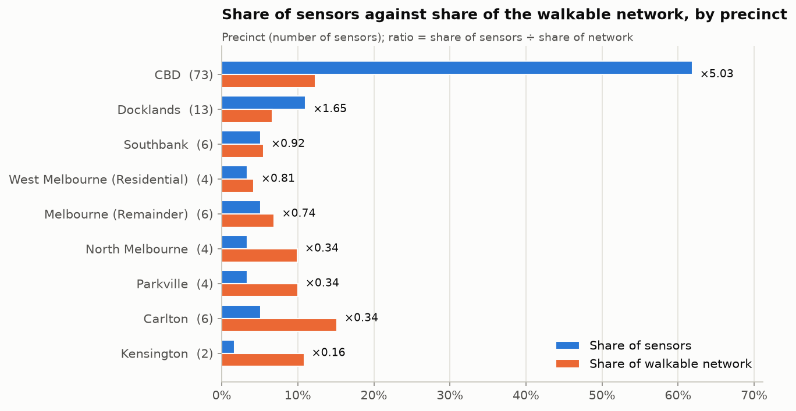
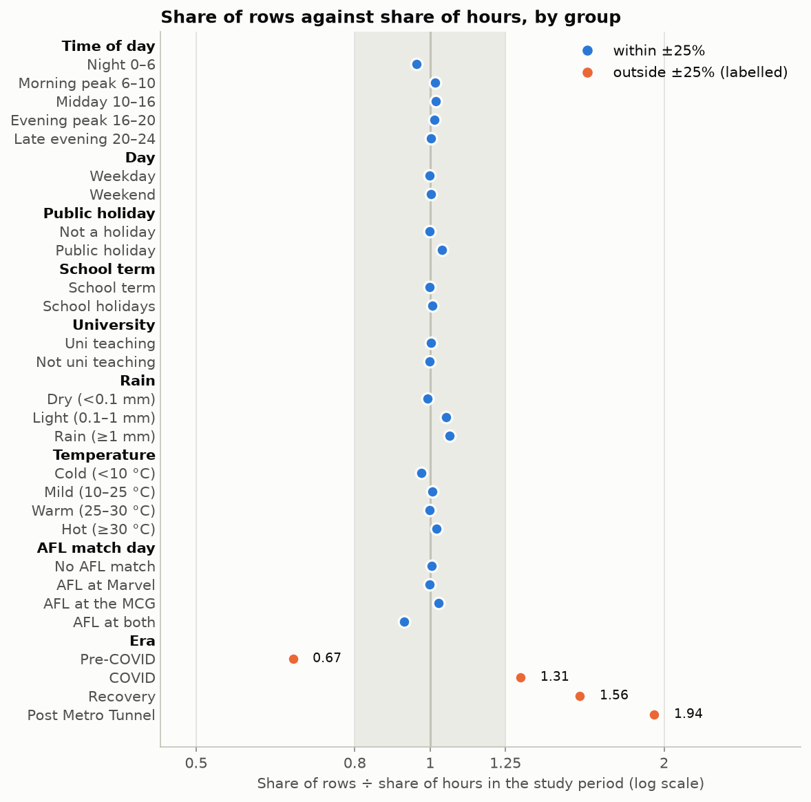
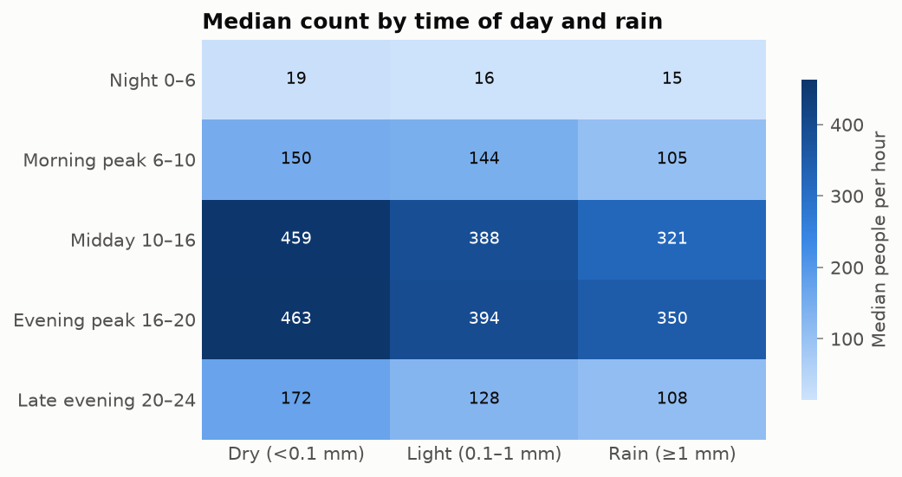
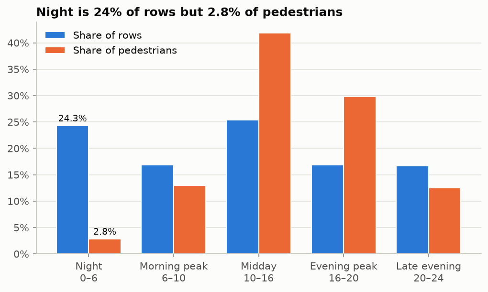
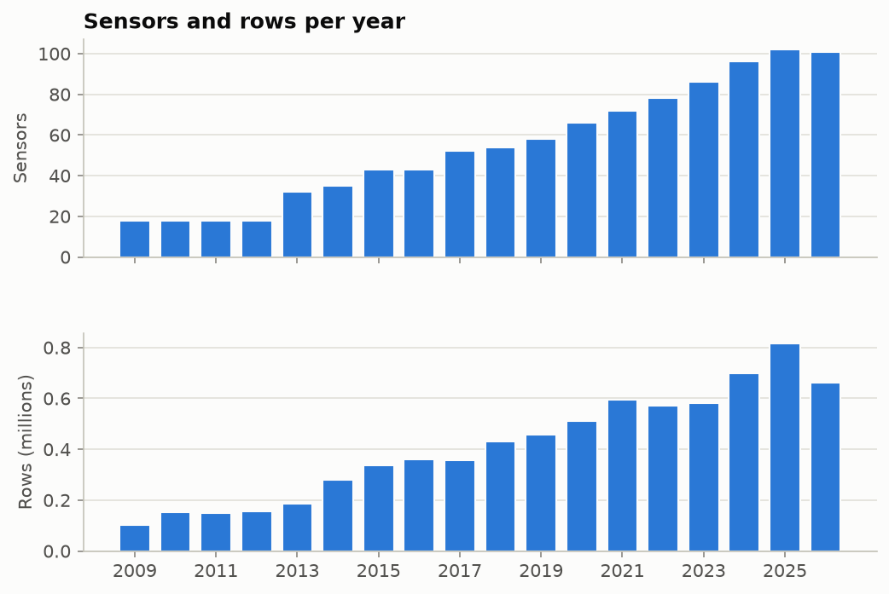
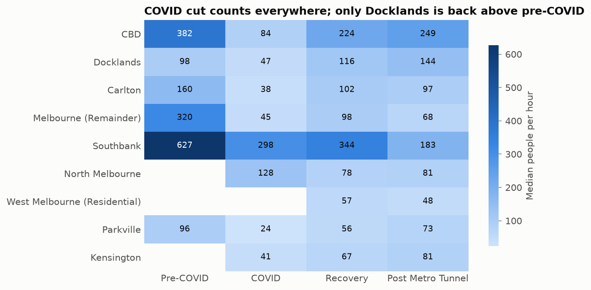
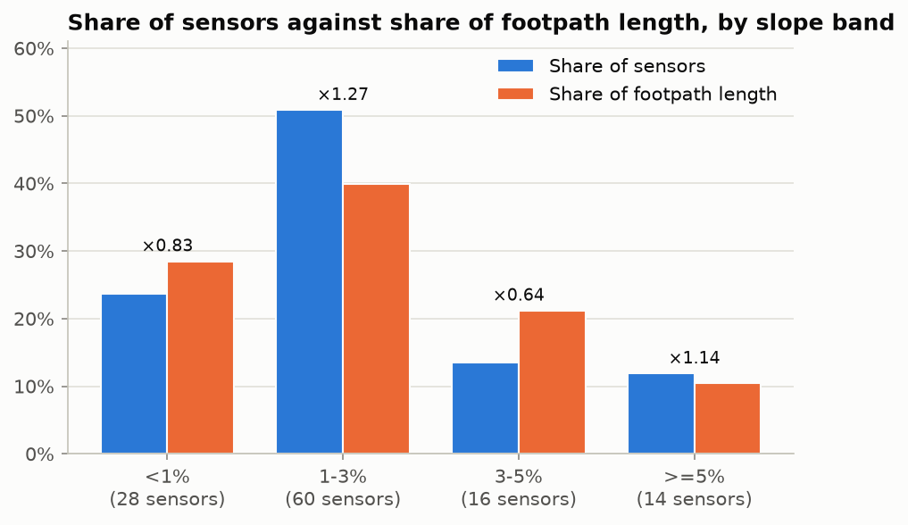

# Bias analysis by data slicing

The data pipeline guidelines ask us to slice the data, check whether some groups are served worse than others, mitigate what we find, and write it down. This page covers the slices, step 1 (how much data each group has), step 2 (where a model's error is worse) and step 3 (what was tried to fix it, and what it cost). Step 4 repeats steps 2 and 3 on the real flow model once it exists.

**Summary.**
- The data is most uneven by place: the CBD has 5 times its share of sensors, and the outer precincts under half of theirs.
- On held-out sensors, a baseline model is clearly worse on quiet sensors, low-amenity sensors, three precincts outside the CBD (Southbank, Docklands and Melbourne (Remainder)), night, public holidays and the COVID era. The thin outer precincts are not among them.
- Reweighting the training rows didn't lower the average error and moved error from some weak groups onto others, so it was rejected. Calibrating each sensor to four weeks of its own counts cut the overall error by about a third and fixed the quiet, low-amenity and Southbank sensors. Night, COVID, Docklands and Melbourne (Remainder) are still worse: their error is in the pattern, which needs changes to the model, not to the weights.

## What "bias" means here

Stoa holds no personal data (CLAUDE.md, core rule 6): the counts are anonymous totals per sensor and hour. There are no age, gender or other demographic fields to slice on, by design. The groups that matter for a pedestrian model are places, times and conditions. A model trained mostly on busy CBD streets in fine weather can look accurate overall and still be poor on a quiet street in Kensington, at night or in the rain. Planners would then get worse forecasts for exactly the places that have the least data.

## The slices

Arshmehar proposed the slice list (her table, and her notebook `notebooks/04_bias_slicing.ipynb`), which also gave the held-out sensor lists, the sensor start period, the count-distribution columns, coverage by year and the cross-tables. The calendar, event, density and sensor-quality slices and the reference comparison were added on top. The **Proposed by** column says which is which. Settings are in `configs/bias.yaml`; the code is `src/bias/slices.py`.

| Slice | Groups | Why it could hide bias | Built from | Proposed by |
|---|---|---|---|---|
| `precinct` | CLUE areas, with the three CBD areas merged | Sensors cluster in the CBD | Sensor location in the City's CLUE areas | Arshmehar (CLUE grouping added) |
| `holdout_precinct` | UniMelb edge (42–44), Carlton (31, 37, 46, 50, 54), North Melbourne (70, 76, 85, 86, 87, 180), the rest | These are the within-Melbourne transfer test | The sensor lists in `docs/PROJECT_CONTEXT.md` 7.1, copied to `configs/bias.yaml`. They don't follow CLUE boundaries: Macaulay Rd (76, 85) is in the Kensington area. | Arshmehar |
| `volume_tier` | Quiet, medium, busy thirds of sensors | Errors on busy sensors dominate absolute metrics | Each sensor's mean hourly count | Arshmehar |
| `amenity_tier` | Low, medium, high thirds | A density proxy (CLAUDE.md asks for error by density) | OSM amenities within 400 m of the matched segment | Added |
| `slope_band` | <1%, 1–3%, 3–5%, ≥5% | Steep paths are rare | `sensor_steepness.parquet` | Arshmehar |
| `slope_source` | Footpath survey, DEM | The 2 DEM sensors use a different method | `place_source` | Arshmehar |
| `sensor_start` | 2009–2013, 2014–2018, 2019 on | Early years rest on a handful of streets | Year of each sensor's first count | Arshmehar |
| `time_of_day` | Night 0–6, morning peak 6–10, midday 10–16, evening peak 16–20, late evening 20–24 | Most pedestrians walk in the day, so night errors are easy to miss | `hour_local` | Arshmehar |
| `day_type` | Weekday or weekend | Different walking patterns | `is_weekend` | Arshmehar |
| `public_holiday`, `school_term`, `uni_teaching` | Each calendar flag | Different walking patterns | The calendar columns (`unknown` where a calendar doesn't cover the year) | Added |
| `rain` | Dry (<0.1 mm), light, rain (≥1 mm) | Rainy hours are rare | `wx_precipitation` | Arshmehar |
| `temperature` | Cold (<10 °C), mild, warm (25–30 °C), hot (≥30 °C) | Hot hours are rare | `wx_temperature_2m` | Arshmehar |
| `era` | Pre-COVID, COVID (16 Mar 2020 to 21 Oct 2021), recovery, post Metro Tunnel (from 30 Nov 2025) | Crowds changed sharply | `date_local` | Arshmehar |
| `afl_day` | Marvel, MCG, both, none | Event days are reported separately (CLAUDE.md, "Evaluation") | AFL Tables attendance | Added |
| `source` | Archive, live, Wayback | Different collection | `source` | Arshmehar |
| `missing_hours` | <5%, 5–20%, ≥20% of hours absent | Unreliable sensors can skew training and evaluation | Hours absent within each source's span for the sensor | Arshmehar |
| `match_review` | Matched automatically, needs review | A sensor on the wrong segment gets the wrong place features | `needs_review` from the sensor match | Added |
| `has_location` | Located, no location | The 18 retired sensors had no place features until their 2022 locations were added; every sensor is located now, and the slice stays as a check | `has_location` | Added |

The cut-offs for rain, temperature and sensor tiers are agreed: Arshmehar's first notebook used wet above 0.2 mm, bands at 10/20/30 °C and the median count, and her notebooks now use the ones above.

Slices are for checking, never features. Precinct, sensor ID, season and month must not go into a model (CLAUDE.md core rule 9); they only group rows so results can be compared.

Rows flagged `suspect_outage_zero` are dropped before the shares are computed, as in training. Each group still reports the share of its rows that were flagged.

## Step 1: the representation report

```bash
.venv/bin/python -m src.bias.representation    # ~40 s
```

It runs as `bias_slices` in the DAG, after `validate`, so it only reports on data that passed the checks (side by side, the two overran Docker's default 8 GB). It needs no model, and writes to `data/processed/bias/melbourne/`:

| File | One row per |
|---|---|
| `slice_representation.csv` | Slice and group |
| `slice_crosstabs.csv` | Pair of groups, for the pairs in `crosstabs` (time of day × rain, precinct × era) |
| `coverage_by_year.csv` | Year: rows, sensors, pedestrians |
| `sensor_slices.csv` | Sensor: its slices and the values behind them (mean count, first year, missing share, slope) |
| `slice_representation_meta.json` | The run: row counts, period, thin groups |

Each group gets its number of sensors and rows, its share of rows and of pedestrians, its mean, median and 90th-percentile count, its share of zero counts and its outage share. Where a reference exists, it also gets a **ratio**: the group's share of the data divided by its share of the reference.
- Time, calendar, weather, era and AFL slices are compared with every hour of the study period. A ratio below 1 means outages, or the sensor network's growth, left that kind of hour short.
- Precincts are compared with the length of OSM walkable network in each CLUE area, using the share of sensors. A ratio below 1 means the precinct has fewer sensors than its share of the network.
- Slope bands are compared with the length of surveyed footpath in each band.

A group is flagged **thin** when it has fewer than 5 sensors or a ratio below 0.5.

The figures below come from `notebooks/04_bias_slicing.ipynb`, which reads these files and `configs/bias.yaml` and writes PNGs to `docs/bias/figures/` (it defines no slices of its own). `notebooks/05_bias_stage1.ipynb` runs the same representation check, with the same cut-offs, on the notebooks' own dataset.

### Findings (run of 22 October 2026)

7.4M sensor-hours from 118 sensors, May 2009 to October 2026. This includes the Wayback fill for November 2022 to October 2024 (1.18M rows, 16% of the table), and every sensor now has a location: the 18 retired sensors are placed from the October 2022 copy of the sensor table.

**Place is where the data is most uneven.**

| Precinct | Sensors | Share of sensors | Share of walkable network | Ratio |
|---|---|---|---|---|
| CBD | 73 | 62% | 12% | 5.11 |
| Docklands | 13 | 11% | 6% | 1.74 |
| Southbank | 6 | 5% | 5% | 0.93 |
| West Melbourne (Residential) | 4 | 3% | 4% | 0.79 |
| Melbourne (Remainder) | 6 | 5% | 7% | 0.79 |
| North Melbourne | 4 | 3% | 10% | 0.34 |
| Carlton | 6 | 5% | 15% | 0.33 |
| Parkville | 4 | 3% | 10% | 0.33 |
| Kensington | 2 | 2% | 11% | 0.15 |

The CBD has five times its share of sensors; Carlton, North Melbourne, Parkville and Kensington have about a third of theirs or less. Three of those are held-out transfer precincts, with 3 to 6 sensors each, so their errors will carry wide uncertainty.



**Time, calendar and weather are represented in proportion.** Every time-of-day, weekday, holiday, school-term, rain, temperature and AFL group has a ratio between 0.93 and 1.06. Outages are not concentrated in particular hours or weather. Some groups are still small in absolute terms: rain of 1 mm or more is 2.5% of rows, and 30 °C or hotter is 1.9%.



Rain lowers counts at every time of day (median 459 dry against 321 in rain at midday), so the weather slices behave differently even though they're represented in proportion.



**Night has rows but few pedestrians.** The night slice (0–6) is 24% of rows and 2.8% of pedestrians. An error metric in absolute numbers would barely register night errors, so step 2 uses relative errors.



**Later eras are over-represented** because the sensor network grew. Pre-COVID is 62% of the hours but 41% of the rows (ratio 0.67); the recovery era is 23% of the hours and 37% of the rows (1.56), and the post Metro Tunnel era 5% of the hours and 10% of the rows (1.94).



Early years rest on 18 sensors (2009–2012, 1.4–2.1% of rows each), against 102 in 2025. Kensington, North Melbourne and West Melbourne (Residential) have no rows before COVID at all, so a model can't learn their pre-2020 pattern. COVID cut counts in every precinct, and of the six precincts with pre-COVID data only Docklands is back above its pre-COVID median.



**Other points:**
- The busiest third of sensors carries 69% of pedestrians.
- The 3–5% slope band has 16 sensors against 21% of surveyed footpath length (ratio 0.64). Only 2 sensors use the DEM slope, too few to judge on their own.

  
- 10 sensors are missing 20% or more of their hours. The least complete are quiet sensors: 73 (67% of hours missing), 124 (64%), 138 (42%) and 140 (41%), so quiet streets are short of data twice over.
- University teaching is unknown for 14% of rows: there's no calendar before 2015.
- 52 of the 118 sensors have a sensor match flagged for review.

## Types of bias found

There are no demographic fields: Stoa holds no personal data (CLAUDE.md, core rule 6), so bias here means places, times and conditions. Sensor counts are given for small groups; conclusions are not drawn from 2–3 sensors (the DEM sensors, UniMelb edge, Kensington).

| Type | What the data shows | Slices |
|---|---|---|
| **Sampling bias by place** (where sensors were put) | The CBD has 73 of 118 sensors against 12% of the walkable network (ratio 5.11). Carlton (6 sensors), North Melbourne (4), Parkville (4) and Kensington (2) have a third of their share or less. | `precinct`, `holdout_precinct` |
| **Volume skew** | The busiest third of sensors (39) carries 69% of pedestrians; the quietest third (40) 6%. The least complete sensors are quiet ones. | `volume_tier`, `missing_hours` |
| **Coverage over time** | 18 sensors in 2009–2012, 102 in 2025. Pre-COVID hours are under-represented (ratio 0.67) and post Metro Tunnel hours over-represented (1.94). Kensington, North Melbourne and West Melbourne (Residential) have no pre-COVID rows. | `era`, `sensor_start`, coverage by year |
| **Era shifts** | Median count 250 pre-COVID, 72 during COVID, 165 in recovery; only Docklands is back above its pre-COVID median. | `era`, precinct × era |
| **Where the pedestrians are in time** | Night is 24% of rows but 2.8% of pedestrians. | `time_of_day` |
| **Rare conditions** | Rain of 1 mm or more is 2.5% of rows, 25–30 °C 4.3%, 30 °C or hotter 1.9%. Only 2 sensors use DEM slope. | `rain`, `temperature`, `slope_source` |
| **Data quality** | 52 of the 118 sensors have a match flagged for review; 10 sensors miss 20% or more of their hours. The 18 retired sensors' locations come from a 2022 table, matched to the 2026 OSM network. | `match_review`, `missing_hours` |

**Not found:** time-of-day, weekday, holiday, school-term, university-term, rain, temperature and AFL groups are each represented in proportion to the hours they cover (ratio 0.93 to 1.06).

## How it was detected

1. **Slices.** The hourly table is split by each slice in the table above (`src/bias/slices.py`, settings in `configs/bias.yaml`). Outage-flagged rows are dropped first, as in training.
2. **Representation.** For each group: rows, sensors, share of rows and of pedestrians, mean, median and 90th-percentile count, zero and outage shares (`src/bias/representation.py`).
3. **Reference ratio.** Each group's share is compared with what it would be if the data were spread fairly: the hours in the study period for time and condition slices, the walkable network for precincts, surveyed footpath length for slope bands. A group is **thin** with fewer than 5 sensors or a ratio below 0.5.
4. **Cross-tables and coverage.** Time of day × rain and precinct × era show problems that appear only where two slices meet; coverage by year shows how the sensor network grew.
5. **Second dataset.** `notebooks/05_bias_stage1.ipynb` repeats the check, with the same cut-offs, on the notebook dataset. The same groups stand out there.

Step 1 measures the **data**. Whether a model is actually worse on these groups is step 2: until then, each finding is a candidate.

## Step 2: where a model is worse

```bash
.venv/bin/python -m src.bias.slice_errors     # ~18 min; the DAG runs it weekly
```

Step 1 found where the data is thin. Step 2 checks whether a model is actually worse there. The real flow model doesn't exist yet, so a baseline stands in for it (`src/bias/slice_errors.py`):
- **Model:** scikit-learn gradient boosting (`HistGradientBoostingRegressor`, Poisson loss) on time, calendar, weather, slope and OSM segment features. Following core rule 9, it has no sensor or segment IDs, no coordinates and no month or day of year.
- **Held-out sensors:** 5 folds grouped by sensor (core rule 2), so every one of the 118 sensors gets predictions from a model that never saw it. Each fold trains on 600,000 sampled rows.
- **Error:** WAPE, the sum of absolute errors divided by the sum of counts, computed per slice group with Fairlearn's `MetricFrame` (MIT). A relative error keeps busy sensors from drowning out quiet ones, and night (2.8% of pedestrians) from disappearing.
- **Uncertainty:** a 95% interval for each group, from resampling its sensors 300 times. Hours from one sensor aren't independent, so resampling rows would overstate the certainty.
- **Worse:** a group is marked worse when its whole interval lies above the overall WAPE.
- **Scored hours:** each sensor's first 28 days are left out of scoring, because step 3's calibration uses them. That leaves 7.3M sensor-hours.

It runs as `bias_errors` in the DAG, after `bias_slices`. It reruns when its last run is a week old or its settings changed, and otherwise finishes at once. Outputs, in `data/processed/bias/melbourne/`:

| File | One row per |
|---|---|
| `slice_errors.csv` | Mitigation, slice and group: WAPE with its interval, bias, MAE, sensors, rows, `worse`, and the slice's disparity ratio (lowest group WAPE / highest) |
| `mitigation_summary.csv` | Mitigation: overall WAPE, bias and MAE, and which groups are worse |
| `slice_errors_meta.json` | The run: features, folds, model settings |

### Findings (run of 22 October 2026)

Overall WAPE is **0.55**, and the baseline under-predicts total volume by 27%. Without any local counts it gets the shape of the day right but not how busy a place is, which is what per-site calibration is for (CLAUDE.md, "Generalization").

Placing the 18 retired sensors brought the overall error down from 0.60. They are mostly busy CBD streets, where the model does well (CBD 0.51), so the bar a group has to clear to count as worse is lower than before.

**Nine groups are clearly worse:**

| Group | Sensors | WAPE | 95% interval | Bias |
|---|---|---|---|---|
| Quiet sensors (lowest third by mean count) | 40 | 0.91 | 0.68–1.30 | +61% |
| Kensington | 2 | 0.86 | 0.57–1.10 | +81% |
| Southbank | 6 | 0.80 | 0.68–0.85 | −75% |
| Low-amenity sensors | 40 | 0.72 | 0.64–0.78 | −51% |
| COVID era | 72 | 0.68 | 0.63–0.73 | −24% |
| Night (0–6) | 118 | 0.67 | 0.62–0.73 | −32% |
| Docklands | 13 | 0.67 | 0.58–0.75 | −22% |
| Melbourne (Remainder) | 6 | 0.67 | 0.59–1.16 | −39% |
| Public holidays | 117 | 0.62 | 0.55–0.68 | −28% |

Kensington has 2 sensors, so no conclusion rests on it. Steep paths (0.73, interval 0.55–0.86) and sensors whose match needs review (0.65, 0.54–0.76) come next: the bottoms of their intervals sit just under the overall error.

The bias column shows two different failures. Quiet sensors are over-predicted (+61%): the model pulls every place toward a typical volume, so the quietest streets come out too busy. Southbank (−75%) and the low-amenity sensors (−51%) are under-predicted. Both hold busy through-routes with few shops nearby, such as Southbank Promenade, Southern Cross Station, Sandridge Bridge and the Convention Centre. Those routes carry most of their pedestrians, and amenity counts don't capture what draws people there.

**Candidates from step 1 that are not worse:**
- **Thin precincts.** Carlton (6 sensors, WAPE 0.47), Parkville (4, 0.51) and North Melbourne (4, 0.52, interval 0.30–1.26) are in line with the CBD (73, 0.51). The precincts that are worse (Southbank, Docklands, Melbourne (Remainder)) are not thin: Docklands has 1.7 times its share of sensors.
- **Held-out transfer precincts.** Carlton 0.47, UniMelb edge 0.51, North Melbourne 0.62 (interval 0.35–1.08). None is clearly worse than the training area (0.55). These are the K-fold errors; the formal transfer test, which trains on the CBD only, is part of model evaluation.
- **Rare weather.** Rain of 1 mm or more (0.58), 30 °C or hotter (0.54) and cold hours (0.60) are in line with dry, mild hours.
- **Late starters and recent hours.** Sensors that started in 2019 or later (0.65, interval 0.51–0.87), the post Metro Tunnel era (0.53) and AFL days (0.55–0.56) are not worse.
- **The Wayback years.** Hours from the Wayback fill have WAPE 0.59 (0.50–0.67), against 0.54 for the archive and 0.55 for the live table.
- **Incomplete sensors.** The 10 sensors missing 20% or more of their hours have WAPE 0.51, interval 0.34–1.37.

So being thin in the data, which step 1 measured, doesn't by itself make a group worse for the model. The worse groups share something else: low volume, through-routes the amenity features don't describe, or a pattern the features don't describe (night, holidays, COVID).

## Step 3: mitigation

Each mitigation is run on the same folds, the same training rows and the same scored hours, so only the mitigation differs (settings in `configs/bias.yaml`, `errors.mitigations`):
- **`sensor_equal`:** every sensor's training rows sum to the same weight, so long-running busy CBD sensors stop dominating the loss.
- **`precinct_to_network`:** each precinct's rows are weighted to its share of the walkable network, the step 1 reference.
- **`calibrated`:** no retraining. Each held-out sensor's baseline predictions are scaled so they add up to its counts over its first 28 days. This is the per-site calibration in CLAUDE.md: the model gives the pattern and a few weeks of local counts give the volume.

| WAPE | Baseline | Equal sensors | Precincts to network | **Calibrated** |
|---|---|---|---|---|
| **Overall** | 0.55 | 0.55 | 0.56 | **0.38** |
| Overall bias | −27% | −27% | −26% | **−1%** |
| Quiet sensors | 0.91 | 0.89 | 1.08 | **0.56** |
| Southbank | 0.80 | 0.76 | 0.76 | **0.39** |
| Low-amenity sensors | 0.72 | 0.70 | 0.70 | **0.50** |
| Steep paths (≥5%) | 0.73 | 0.70 | 0.69 | **0.50** |
| Match needs review | 0.65 | 0.62 | 0.60 | **0.40** |
| Public holidays | 0.62 | 0.61 | 0.62 | **0.48** |
| COVID era | 0.68 | 0.67 | 0.66 | 0.67 |
| Night | 0.67 | 0.67 | 0.71 | 0.66 |
| Docklands | 0.67 | 0.62 | 0.65 | 0.66 |
| Melbourne (Remainder) | 0.67 | 0.65 | 0.61 | 0.67 |
| CBD | 0.51 | 0.52 | 0.54 | 0.34 |
| Carlton (held out) | 0.47 | 0.52 | 0.52 | 0.58 |
| North Melbourne (held out) | 0.62 | 0.77 | 0.52 | 0.32 |

`mitigation_summary.csv` lists the groups each mitigation leaves worse than its own overall error. Calibration lists 16 because its overall error is so much lower; the table above compares every mitigation on the same groups.

**Reweighting: tried and rejected.** Neither weighting lowered the overall error (0.55 and 0.56), and each moved error from some weak groups onto others.
- **Equal sensor weights** helped Southbank (0.80 to 0.76), Docklands (0.67 to 0.62) and the low-amenity and steep sensors a little. The held-out precincts paid for it: Carlton went from 0.47 to 0.52, the UniMelb edge from 0.51 to 0.66 and North Melbourne from 0.62 to 0.77.
- **Precincts to network** cut the groups worse than overall from 9 to 5, mainly by bringing Kensington (2 sensors, 0.86 to 0.64) and Melbourne (Remainder) (0.67 to 0.61) closer. Quiet sensors went from 0.91 to 1.08 and night from 0.67 to 0.71, so the gap between quiet and busy sensors widened (disparity ratio 0.57 to 0.48).

The weak groups aren't under-weighted: the features don't tell the model how busy a quiet place is, and more weight on those rows doesn't add that information.

**Calibration: adopted where local counts exist.** It cuts the overall error by about a third and removes the overall bias. The volume and place groups whose error is mainly in the level improve most: quiet sensors from 0.91 to 0.56, Southbank from 0.80 to 0.39, low-amenity from 0.72 to 0.50 and steep paths from 0.73 to 0.50. Calibrated forecasts are the right default wherever a few weeks of counts are available.

**Not fixed:**
- **Night and COVID.** These are errors in the pattern over the day and over the years, not in the level, so scaling can't fix them. Because calibration improves daytime hours far more, the relative gap on time of day widens (disparity ratio 0.75 to 0.50), and the same happens on era (0.77 to 0.47). Both are reported separately until the model changes (next steps).
- **Docklands and Melbourne (Remainder).** Calibration leaves them where they were (0.66 and 0.67) with little bias left (−2% and +9%), so their error is also in the pattern over the day or the week, not the volume.
- **Carlton and the UniMelb edge.** Calibration made Carlton worse, 0.47 to 0.58, and turned a small under-prediction into a 29% over-prediction. The UniMelb edge kept its error (0.51 to 0.49) but now over-predicts by 27%. These sensors' first 28 days don't look like their later years, so a calibration window has to be chosen with care: a short count taken in an unusual month calibrates every later forecast wrongly.

## Mitigation plan and outcome

Arshmehar's plan, written before step 2, with what was found and done:

| If the model is worse on... | Planned mitigation | Outcome |
|---|---|---|
| Thin precincts and held-out precincts | Weight training rows so each precinct or sensor counts equally; report held-out precincts separately, with sensor counts and intervals | Thin and held-out precincts are not worse than overall. Three better-covered precincts are (Southbank, Docklands, Melbourne (Remainder)). Both weightings were tried and rejected (above); calibration fixes Southbank only. Held-out precincts are reported separately in `slice_errors.csv`. |
| Quiet sensors | Relative error; weight sensors equally | Worse (0.91). Relative error is used throughout. Equal sensor weights barely helped (0.89); calibration did (0.56). |
| Night | Relative error, and night reported separately | Worse (0.67), and not fixed by weights or calibration. Reported separately; needs model changes. |
| Early years, short sensor histories | Weight by sensor-year, or a recent-window model | Not worse: sensors from 2019 on have WAPE 0.65, interval 0.51–0.87. No action. |
| COVID and post Metro Tunnel | Keep the flags; report post Metro Tunnel separately | COVID is worse (0.68) and unfixed; post Metro Tunnel is not worse (0.53). Both reported separately. |
| Rain, heat, DEM sensors | Report separately; weight up if much worse | Rain and heat not worse. The 2 DEM sensors are too few to judge. No action. |
| Missing years | Bring the Wayback fill into the pipeline | Done (Arshmehar, PR #16): 1.18M rows for November 2022 to October 2024. Those hours are not worse (0.59). |
| Sensors with no location | Locations for the 18 retired sensors from the October 2022 sensor table | Done: `sensor_match.load_sensor_locations` places them from the Wayback copy of that table, so all 118 sensors are in every slice and in the evaluation. |
| Incomplete sensors and flagged matches | Report sensors missing 20% or more separately; hand-check the 52 flagged matches | Flagged matches (0.65) sit just under the line for worse, and calibration brings them to 0.40; the hand check still matters for accuracy. The 10 incomplete sensors are not worse (0.51, interval 0.34–1.37). |
| Outage zeros | Already dropped | Dropped from training and scoring. |

## Trade-offs

- **Average against gap.** Neither weighting lowered the overall error, and each moved error between weak groups: equal sensor weights onto the held-out precincts, precinct weights onto quiet sensors. Since the point of the step is the weak groups, neither is worth it.
- **Calibration needs counts.** It works only where a short local count exists. Segments that have never been counted keep the uncalibrated error, which is worst on quiet, low-amenity streets. Any forecast for an uncounted place should say it is uncalibrated.
- **Calibration widens the time gap.** It helps daytime far more than night, so night's relative disadvantage grows even though its error doesn't get worse.
- **The calibration window matters.** Four weeks that aren't typical (Carlton) make every later forecast worse. A longer or more recent window would be safer, at the cost of needing more counts.
- **Relative error.** WAPE makes night and quiet streets visible but understates busy-hour errors in people terms, so MAE is reported beside it (`mae` in `slice_errors.csv`).
- **Small groups.** Groups of 2–6 sensors have wide intervals. They're reported, not optimised for: tuning a model to 2 sensors would overfit them.
- **The Wayback fill** comes from an archived copy of the City's own export, which matched the archive on about 98.5% of overlapping hours. It filled two years and moved the results only slightly (overall WAPE 0.58 before, 0.60 after, before the retired sensors were placed), and the `source` slice keeps it checkable.
- **The retired sensors' locations** come from a 2022 table and are matched to the 2026 OSM network, so a sensor whose street has since changed can land on today's layout. Their matches go through the same review flags as the others.

## Next steps

1. **Rerun on the real flow model (step 4).** `slice_errors()` takes any model's out-of-fold predictions, so the flow model's evaluation can produce the same table.
2. **Night, COVID and the pattern errors.** Try a lockdown-stringency feature for COVID, and either a separate low-count model or a log-scale loss for night, then rerun step 3. Docklands and Melbourne (Remainder) need the same look: calibration doesn't reach their error.
3. **Calibration window.** Compare 4 weeks, 8 weeks and the most recent 4 weeks, and pick the default for the per-site calibration.
4. **Hand-check the 52 flagged sensor matches.** Flagged sensors are near the line for worse in step 2, so wrong segments may be costing accuracy.
