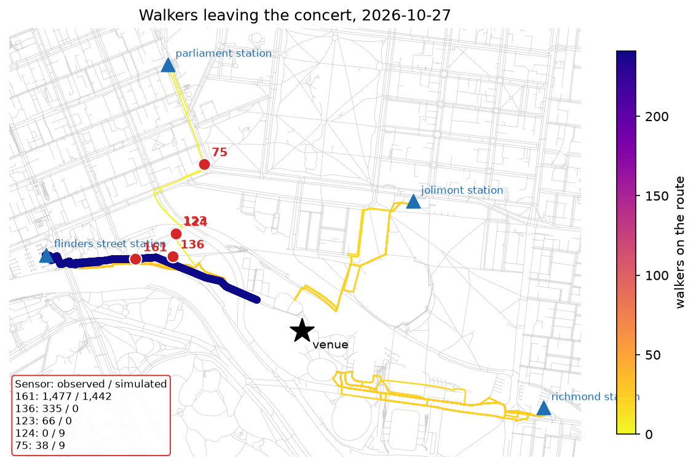
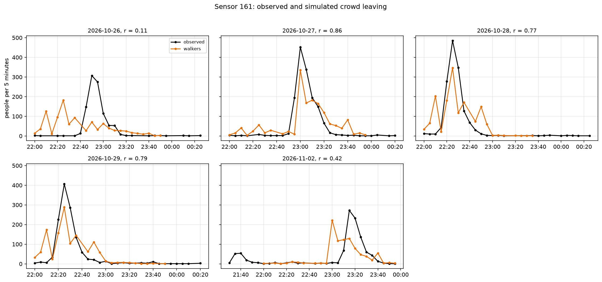
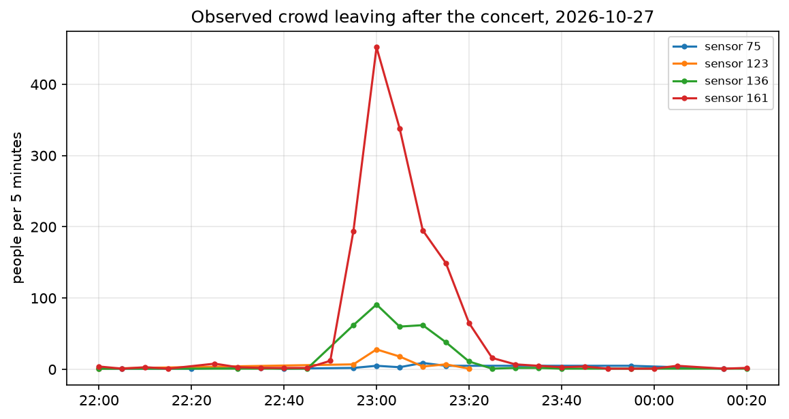
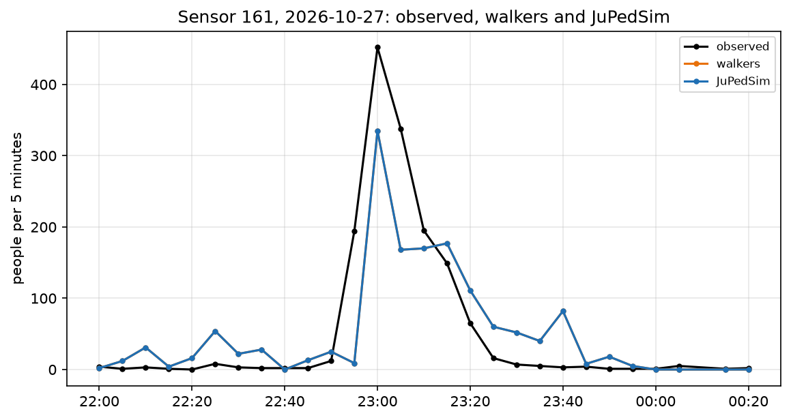

# Observed egress at Melbourne Park

The first steps of the simulation in [getting_started.md](getting_started.md): the
observed series that the walkers and JuPedSim are compared with, and the walkers
themselves.

## Observed egress

`src/simulation/observed.py` takes each concert at Rod Laver Arena and builds the counts at
sensors 161, 136, 123, 124 and 75 in 5-minute blocks and by direction, from 2.5 to 5 hours
after the advertised start (no end times are published). Settings are in
`configs/simulation.yaml`; outputs go to `data/simulation/melbourne_park/`
(`observed_egress.parquet` and `observed_summary.csv`).

```bash
.venv/bin/python -m src.simulation.observed --area melbourne_park
```

On the archive to 11 November (8 of the 14 concerts listed):

| Night | Concert | Total at 161 | Peak block at 161 | Peak count at 161 | Total at 136 |
|---|---|---|---|---|---|
| 25 Oct | Hans Zimmer Live | 634 | 23:10 | 261 | 22 |
| 26 Oct | Hilary Duff | 994 | 22:50 | 307 | 199 |
| 27 Oct | Hilary Duff | 1,477 | 23:00 | 452 | 335 |
| 28 Oct | Lily Allen | 1,448 | 22:25 | 485 | 99 |
| 29 Oct | Lily Allen | 1,271 | 22:25 | 406 | 106 |
| 2 Nov | 5 Seconds of Summer | 1,028 | 23:15 | 272 | 177 |
| 8 Nov | Daniel Caesar | 32 | 21:50 | 4 | 3 |
| 9 Nov | Daniel Caesar | 35 | 21:30 | 4 | 5 |

- Sensor 161 carries the crowd (1,000 to 1,500 a night); 136 sees about a tenth to a
  quarter of it, peaking in the same block or 5 minutes later. 123 and 75 see 13 to 66
  people and 124 almost none, so most of the crowd leaves the route after 161. 161 is the
  main sensor to compare with, and 136 the second; peak delays at the others are noise.
- 27 October matches the 1,417 people at 161 between 22:50 and 23:30 noted in
  getting_started.md.
- The Daniel Caesar shows on 8 and 9 November were cancelled for health reasons (reported
  in early November), so there was no crowd. Their entries in `configs/events.yaml`
  should be marked or removed.
- 25 October and 28 October had another event at Melbourne Park the same night.
- None of the five sensors are among the eight that skip minutes :00 to :04.

## Walkers

`src/simulation/walkers.py` follows steps 1 and 2 of getting_started.md. Walkers leave
from the graph nodes within 60 m of Rod Laver Arena, towards Flinders Street, Richmond,
Jolimont and Parliament stations, on 20 noisy shortest paths per destination.

Walkers per route are fitted with non-negative least squares to the hourly counts at
22:00 and 23:00 at sensors 161, 123, 124 and 75, less the usual count for that hour, so
that only the concert crowd is fitted. The usual count is the 25th percentile of the same
weekday and hour over the 8 weeks before, skipping listed event days; Melbourne Park has
unlisted events most weeks, which pushed a median up to over 500 people. Sensor 136 is
left out of the fit as the test. Each walker's time at its first sensor is drawn from
sensor 161's event-exit minute profile, and later sensors follow at 1.3 m/s. Settings are
under `walkers:` in `configs/simulation.yaml`.

```bash
.venv/bin/python -m src.simulation.walkers --area melbourne_park --night 2026-10-27
```

Sensor 161 on the five concert nights:

| Night | Observed | Usual (both hours) | Simulated | Observed peak | Simulated peak | Correlation |
|---|---|---|---|---|---|---|
| 26 Oct | 994 | 30 | 960 | 22:50 | 22:25 | 0.15 |
| 27 Oct | 1,477 | 22 | 1,442 | 23:00 | 23:00 | 0.87 |
| 28 Oct | 1,448 | 23 | 1,412 | 22:25 | 22:25 | 0.77 |
| 29 Oct | 1,271 | 40 | 1,224 | 22:25 | 22:25 | 0.81 |
| 2 Nov | 1,028 | 39 | 846 | 23:15 | 23:00 | 0.37 |

**These results are not validated.** 161 is in the fit, so matching its totals is
expected. The test sensor, 136, gets no sampled routes on any night: shortest paths on
distance alone don't follow the river path the crowd takes after 161. 123 also gets no
routes, and 75 and 124 get only a few walkers.

- The peak block at 161 matches on 27, 28 and 29 October. On 26 October and 2 November
  the simulated peak comes 15 to 25 minutes early: the minute profile is pooled across
  nights, so a show that finishes at an unusual time puts the peak in the wrong part of
  the hour. 2 November also loses part of its crowd that leaves after midnight, outside
  the fitted hours.
- The minute profile comes from the same archive, including these nights, so the timing
  at 161 is not an independent test either.
- Walkers on routes that pass no fitted sensor stay at the prior, so the total crowd is
  rough.

### Figures

Produced by `src/simulation/figures.py`:

```bash
.venv/bin/python -m src.simulation.figures --area melbourne_park \
    --map-night 2026-10-27 --nights 2026-10-26 2026-10-27 2026-10-28 2026-10-29 2026-11-02
```



The walkers' routes from Rod Laver Arena, thicker and darker where more walkers go, with
the sensors (red) and the stations they head to (blue).



Observed (black) and simulated (orange) people per 5 minutes at sensor 161.



## JuPedSim around sensor 161 (27 October)

`src/simulation/microsim.py` follows step 3 of getting_started.md. It takes the walkers on
the routes past sensor 161, builds a corridor along each route from 150 m before the
sensor to 150 m after it, 6 m wide, and moves them through it with JuPedSim's Collision
Free Speed Model. Each walker enters when it would reach 161 at the walkers' time, and a
line across the path at 161 counts them per 5 minutes. JuPedSim runs in its own
environment (LGPL-3.0, getting_started.md):

```bash
jps-env/bin/python -m src.simulation.microsim --area melbourne_park --night 2026-10-27
```

| Source | Total | Peak block | Peak count | Correlation with observed |
|---|---|---|---|---|
| Observed | 1,477 | 23:00 | 452 | |
| Walkers (fixed speed) | 1,442 | 23:00 | 335 | 0.87 |
| JuPedSim | 1,442 | 23:00 | 335 | 0.87 |



- JuPedSim matches the walkers block for block. At most 273 people were in the 1,792 m2
  corridor at once, about 0.15 per m2, well below the densities where walking slows, so
  crowding moves no one into another 5-minute block.
- So the lower simulated peak at 161 (335 against 452) doesn't come from crowding on this
  path. It comes from when people leave, which the departure-spread calibration addresses.
- The corridor's 6 m width is an assumption (OSM has no width for most of these paths),
  and buildings aren't cut out yet. JuPedSim should matter more at narrower points such
  as bridges and station entrances.
- These results are planning guidance for outdoor approach areas, never a crowd-safety
  assessment (core rule 7).

## Next

1. A route cost with path type, slope, shade and crossings, so routes follow the river
   path, then the test at sensor 136.
2. Calibrate the departure spread per night, fitting on some concert nights and testing
   on others.
3. A wider JuPedSim area with real path widths and buildings cut out, including the
   bridges and station entrances where crowding matters.
